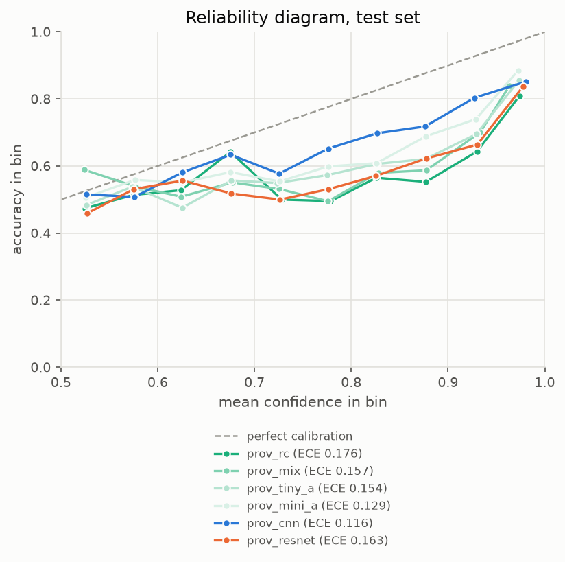
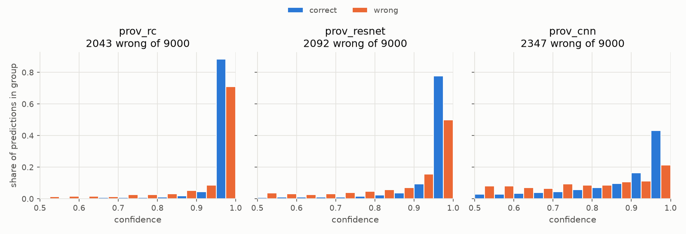
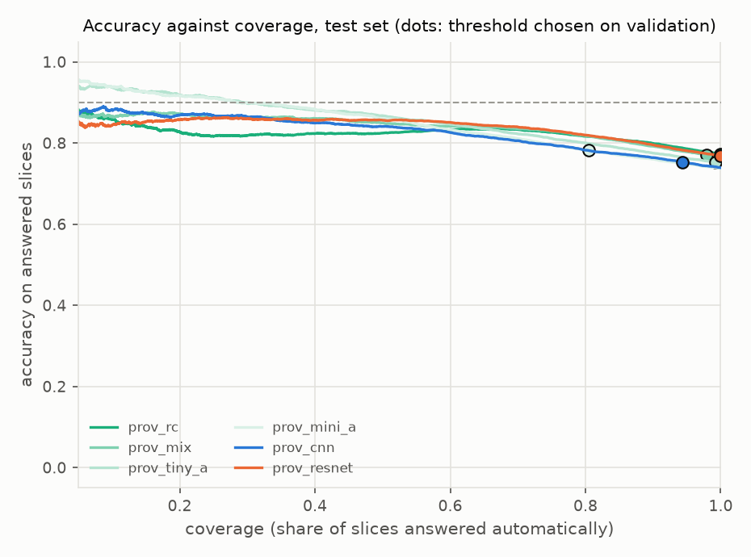
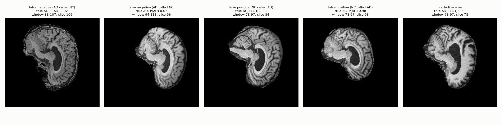

# ConvNeXt for Alzheimer's Disease Classification from ADNI Brain MRI

## 1. Introduction and Summary
This report studies whether a convolutional neural network can separate
patients with Alzheimer's disease (AD) from cognitively normal (NC) controls
using single two-dimensional slices of brain MRI from the ADNI dataset, a 
task that matters due to the fact that an inexpensive first-pass screen could
help decide who is seen sooner. The algorithm is a ConvNeXt, a convolutional
network modernised with large 7x7 depthwise convolutions, inverted bottleneck
blocks, layer normalisation, GELU activations, layer scale and stochastic
depth, implemented from scratch for one-channel input and two output classes
in a Tiny (27.8 million parameters) and a Mini (8.5 million) variant. It is
compared against two small baselines, a four-stage SimpleCNN of 97,650
parameters and a SimpleResNet of 700,146, and against a window-only baseline
that predicts the label from nothing but the slice window of a scan. The 
primary metric is per-slice accuracy on the provided test split of 9,000
slices from 331 patients.

The headline model, a ConvNeXt-Tiny trained with a resize-and-crop recipe,
reaches a per-slice test accuracy of 0.773 (95% interval 0.730 to 0.818, 
resampling patients). That is 14 points above the window-only baseline (0.631) and
above the SimpleCNN (0.739), but it is statistically indistinguishable from
the SimpleResNet (0.768), which has about forty times fewer parameters, so
the architecture is not justified by accuracy alone. The point estimate falls
short of 0.80, although the interval contains it. The more important finding
concerns the data. The number in each filename identifies a scan and not a 
patient (1,526 scans belong to 680 patients), and 216 of the 331 test 
patients also appear in the training folder. On those patients the headline 
model scores 0.94, and on the 115 it never saw it scores 0.50, so the 
headline accuracy largely reflects recognition of patients already seen. A 
patient-disjoint split, built from the metadata, was therefore used for 
development, and on it validation accuracy falls from 0.89 to 0.93 to 0.67 
to 0.69 for the same recipe. As additional analysis, averaging predictions 
over each patient’s slices gave a patient-level test accuracy of 0.794 for a 
ConvNeXt-Tiny on that clean split, at a threshold chosen on validation 
patients alone.

Beyond accuracy, every trained model misses approximately four in ten AD 
slices at the default decision rule and is overconfident in doing so, with
expected calibration errors between 0.12 and 0.18, which section 9 examines
together with confidence, rejection of uncertain cases, resource cost and
failure cases. The recommendation is to use the headline model as the
slice-level scorer for the task and the patient-level model, with a threshold
of 0.30 as the decision for patient triage: patients marked AD should be 
seen with higher priority, whilst patients marked NC must not be treated as
cleared, since a mark of NC may not mean cognitively normal, rather just a 
lower priority.


## 2. The Problem and the Algorithm
The task at hand is a binary classification problem on complex medical
images: given a singular two-dimensional slice taken from a T1-weighted
structural brain MRI, can it be decided whether the slice comes from a
patient that has Alzheimer's disease (AD), or from that of a cognitavely
normal control group (NC). The signal is anatomical and diffuse; atrophy of
the hippocampus and cortex, and enlargement of the ventricles present
themselves as subtle changes in both shape and texture, varying against a
background of natural differences in head shape and age between people. A
classifier therefore must learn which structural patterns carry diagnostic
information, and which are merely variation of the individual person. 
Furthermore, it must do so from a limited number of patients, due to the
highly correlated nature of each slice, many coming from the same patient.

Convolutional networks suit this setting for the fact that they incorporate
two key assumptions that the images satisfy. Firstly, nearby pixels are
related, and the same local pattern can matter anywhere within a particular
image. ConvNeXt, introduced by Liu et al. (2022) is a modernised form of the
convolutional network -- it begins as a ResNet, and continually adopts the
design decisions that resulted in the success of vision transformers, whilst
retaining the pure convolutional nature that gives it its name. The resultant
fransework is a network that matches transformer-style accuracy without
attention, which keeps it simple in terms of implementation, efficient on a 
single GPU, and well behaved on smaller-scale datasets. In this project, the
ConvNet for the 2020s (ConvNeXt) is implemented from scratch in PyTorch and
trained from random initialisation.

The network processes a slice in a fixed sequence of steps: a patchifying
stem and a 4 by 4 convolution with stride 4 followed by layer normalisation
turns the 224 by 224 slice into a 56 by 56 map of 96 channels. This map then
passes through four stages of residual blocks, with 3, 3, 9, and 3 blocks in
the Tiny variant. Between stages, a layer normalisation and a 2 by 2
convolution with stride 2 halve the spatial resolution, and double the
channels, producing maps of 28 by 28 with 192 channels, 14 by 14 with 384,
and finally 7 by 7 with 768. Each block applies a 7 by 7 depthwise
convolution, which gathers wide spatial context cheaply by filtering each
channel separately, then a layer normalisation, then an inverted bottleneck:
a linear layer expanding the channels fourfold, a GELU activation, and a
linear layer projecting back. The block output is multiplied by a learnable
per-channel scale, initialised at 1e-6 so that each block starts close to
the identity and training begins from a stable point, and is added back to 
the block input through a residual connection. Stochastic depth randomly
drops entire residual branches during training, with a probability that
increases with depth, which serves to regularise the network. After the last
stage, global average pooling collapses each feature map to a singular
number per channel, and a layer normalisation, dropout and a linear layer
turn the 768 values into two logits. A softmax converts them into 
probabilities of NC and AD, and the probability of the predicted class is the
confidence score analysed further in Section 9. 

Two size presets were used. The Tiny variant has the depths and widths
mentioned above, and 27,818,594 parameters. The Mini variant has stage depths
of 2, 2, 6, and 2, and widths of 64, 128, 256, and 512, with 8,531,650
parameters, and is used to test whether the extra capacity assists. For
comparison, two small baselines were implemented: a four-stage plain CNN with
97,650 parameters, and a compact ResNet with 700,146 parameters, both
operating on the same inputs and evaluated against the same splits, so that
the added complexity of ConvNeXt can truly be examined. 


## 3. Feasibility review

### Feasibility Review: AD vs CN Classification on ADNI with ConvNeXt

COMP3710 Pattern Recognition | William O'Driscoll, 48849470

#### 1. User need, scope and acceptance criteria

User: A clinician reviewing screening T1-weighted brain MRIs who needs a classifier that decides confident cases automatically and routes uncertain ones to an expert. Scope. A prototype classifying 2D ADNI slices as Alzheimer's disease (AD) or cognitively normal (CN), and testing whether its confidence is trustworthy compared with simpler baselines (the open dilemma). Targets are provisional.

1. Accuracy: per-slice test accuracy ≥ 0.80 on a subject-level split, with a 95% bootstrap interval resampled over subjects.
2. Beyond the shortcut: exceed the slice-window-only baseline (66.2% on test) and, within each mixed-class window, exceed that window's majority-class rate.
3. Calibration: ECE and reliability diagrams for the CNN, ResNet and ConvNeXt, comparing confidence on correct and wrong predictions; ConvNeXt compared with the baselines on macro-F1, AUROC and ECE.
4. Reject option: a confidence threshold giving ≥ 0.90 accuracy on accepted slices at ≥ 50% coverage, with coverage and residual errors reported.
5. Resources: peak GPU memory ≤ 16 GB and ≤ 6 h per training run on one A100.

#### 2. Model choice and course concepts

Data: ADNI AD/CN 2D slices (256×240 grayscale, 20 per scan), zero-padded to 256×256 so stage resolutions halve cleanly. Model: a reduced ConvNeXt (Liu et al., 2022; Hard difficulty) trained from scratch, as pretrained weights are not permitted. ConvNeXt-T uses four stages with 3, 3, 9 and 3 blocks and widths of 96 to 768. The reduced model keeps the same block design (4×4 patchify stem, 7×7 depthwise convolution, LayerNorm, 4× inverted bottleneck with a single GELU, layer scale and stochastic depth) but uses fewer blocks and channels to suit the dataset size and compute budget. In the paper's ablations these design steps raise ImageNet-1K top-1 accuracy from 78.8% to 82.0% (ResNet-50 regime). That evidence comes from far larger data, so transfer to small brain-MRI data is tested, not assumed. Training uses AdamW with weight decay and a cosine schedule. Augmentation is mild (small rotation, shift, scale and intensity jitter) with no flips, because left–right flips of these sagittal-looking slices would swap the front and back of the head. Baselines: window-only, CNN and ResNet on identical splits, giving a progression from no anatomy, to plain local filters, to residual local filters, to a modern design. Evaluation: per slice, as recommended for 2D models, with confidence intervals resampled over subjects. Course concepts: convolutional inductive bias, normalisation, regularisation (weight decay, stochastic depth, augmentation), probabilistic calibration and selective prediction (risk–coverage).

#### 3. Preliminary feasibility evidence

Data audit (1,526 scans, 680 subjects, 30,520 slices): the provided train/test folders share 216 of 331 test subjects, so all scans are pooled and re-split by subject (70/15/15, seed 42). The test set holds 102 subjects (33 AD), 219 scans and 4,380 slices. No subject has both classes. Slice window is strongly tied to class: a window-only rule fitted on the training split scores 66.2% on test (65.5% validation) against 55.7% for always predicting the training majority, so about 10 points of any result can come from slice depth alone. Accuracy is therefore also reported per window. Pipeline test: a short run (3 epochs on a 2,000-slice subset) exercised data loading, the CNN, the training loop and checkpointing end to end; accuracy at that scale is not meaningful.

#### 4. Risks, budget, next experiment and fallback

Risks and mitigations: (i) the subject-level split lowers accuracy relative to the leaking provided split, and 0.80 may be hard from scratch; stochastic depth, weight decay, augmentation and early stopping on validation address overfitting. (ii) The slice-window shortcut; the window-only baseline, per-window accuracy and a window check on failure cases expose it. (iii) A small effective test set (102 subjects) gives wide intervals; differences between models are claimed only where bootstrap intervals separate. (iv) GPU queue waits of about 12 h limit the number of runs; jobs are submitted early as batch scripts, tested on small subsets first, with several configurations per job where possible. Budget: one A100 through Slurm batch jobs, each capped at 6 h, with a planned total of about eight runs (CNN, ResNet, three to four ConvNeXt configurations and final seeds). Next experiment: a full CNN baseline run, then a first ConvNeXt run after a one-batch overfitting check. Fallback: if ConvNeXt misses 0.80, first reduce width and depth or strengthen regularisation; if it is still short, report the result, since the calibration, reject-option and failure analysis carry the dilemma investigation. A second architecture (GFNet) is only attempted after the core analysis is complete.


## 4. Dependencies and Reproducibility
All of the experiments were run on the Rangpur cluster from the University
of Queensland, in a Miniconda environment named torch, with Python 3.11.15,
on a single NVIDIA A100 40GB GPU (PCIe) allocated through Slurm in the
comp3710 partition. The code depends on PyTorch 2.13.0 built for CUDA 13.0
with cuDNN 9.20.0, torchvision 0.28.0, NumPy 2.4.6, Pillow 12.3.0, 
Matplotlib 3.11.1 and scikit-learn 1.9.1. These versions are pinned in
requirements.txt. PyTorch 2.6 or later is assumed: checkpoints are loaded
with weights_only=False because they carry the training configuration
alongside the weights, and the scripts are written for that behaviour. The
data are read in place from the course directory /home/groups/comp3710/ADNI
and are not copied into the repository.

Every source of randomness controlled by the code is seeded. A single seed
of 42 fixes the subject-level split, the stratified division of the provided
training folder into training and validation sets, weight initialisation,
data-loader shuffling, augmentation and mixup. The normalisation statistics
are computed from the training images of the chosen split and written to a
file on first use, so that each protocol has its own unique statistics file.
Runs are not bitwise reproducible by default, since cuDNN autotuning, mixed-precision arithmetic, and multi-worker data loading introduce small
nondeterministic differences. Passing the --deterministic flag disables
autotuning and makes repeated runs on the same hardware much closer, at the
cost of speed, but does not guarantee identical results across different GPUs
or library versions. Every reported result comes from a single seed, so
differences of about a point between runs should be read as within run-to-run
noise, and this limitation is discussed further in Section 10.

Each training run is a singular Slurm job that executes train.py. The 
ConvNeXt-Tiny headline run on the provided split can be reproduced with the
first command below. The remaining commands reproduce the other models in the
experiment ladder, the two baselines, and the patient-disjoint development
runs discussed further. Evaluation on the test set happens once, at the end
of a job, when --eval-test is given, and a job reports the test accuracy of
the checkpoint with the best validation accuracy. A 100-epoch ConvNeXt run
takes between 2.8 and 3.3 hours on the A100 (173 minutes for the resizecrop
Tiny model, and 197 for the Tiny model with default recipe, which uses 
larger inputs), and the baselines also sit inside the six-hour limit of the
job script.
```
# headline experiment ladder, provided split
sbatch slurm/train.sh --recipe resizecrop --variant tiny --epochs 100 --split-mode provided --eval-test --run-name prov_rc
sbatch slurm/train.sh --recipe resizecrop --variant tiny --epochs 100 --patience 100 --mixup-alpha 0.4 --split-mode provided --eval-test --run-name prov_mix
sbatch slurm/train.sh --variant tiny --split-mode provided --eval-test --run-name prov_tiny_a
sbatch slurm/train.sh --variant mini --split-mode provided --eval-test --run-name prov_mini_a

# baselines, provided split
sbatch slurm/train.sh --model cnn --recipe resizecrop --epochs 100 --split-mode provided --eval-test --run-name prov_cnn
sbatch slurm/train.sh --model resnet --recipe resizecrop --epochs 100 --split-mode provided --eval-test --run-name prov_resnet

# supplementary development runs, patient-disjoint split (the default split mode)
sbatch slurm/train.sh --recipe resizecrop --variant tiny --epochs 100 --run-name tiny_rc
sbatch slurm/train.sh --recipe resizecrop --variant tiny --epochs 100 --patience 100 --mixup-alpha 0.4 --select-metric patient_auc --run-name tiny_mix
sbatch slurm/train.sh --recipe resizecrop --variant tiny --epochs 100 --patience 100 --select-metric patient_auc --run-name tiny_pauc
sbatch slurm/train.sh --variant tiny --run-name tiny_a
sbatch slurm/train.sh --variant mini --run-name mini_a
```

Predictions, confidence and failure analyses, and the profiling table are
produced from the saved checkpoints without need for retraining. The script's
per_patient.py and export_preds.py write each model's predicted probabilities
for the validation and test slices to results/preds, and the analysis scripts
of Section 9 read only those files, so the figures and tables in this report
can be regenerated in a few minutes once the checkpoints exist. Slurm reads
the above code when a job starts, so the repository should be at the latest
commit before any job is submitted. Training logs, checkpoints, and
normalisation statistics are generated by the scripts and not commited to the
repository.


## 5. Dataset, Preprocessing, and Splits
The data are all T1-weighted structural brain MRIs from the Alzheimer's
Disease Neuroimaging Initiative (ADNI), supplied as two-dimensional grayscale
JPEG slices of 240 by 256 pixels in the course directory, which is organised
into train and test folders, and then into AD and NC subfolders. Each file is
named with a scan number, followed by a slice number, for example,
392586_92.jpeg, and every scan contributes 20 slices, so the full collection
holds 30,520 slices from 1,526 scans. The metadata file meta_data_with_label.json gives the diagnosis for each scan, and a path from which the patient
identifier can be read. That identifier shows that the 1,526 scans belong
to only 680 patients, corresponding to approximately 2.2 scans per patient,
and that no patient has scans from both diagnosis groups. The number at the
start of each filename therefore identifies a scan rather than a patient,
and treating it as a patient identifier would place one person's scans on
both sides of a split.

Each scan also has a slice window, which is the lowest and highest index
slice observed for it, and the window carries class information. A rule that
predicts from the window alone, fitted on training data, scores well above
chance: 66.2% on the patient-disjoint test set and 63.1% on the provided test
set, against 55.7% and 50.4% for always predicting the majority class. Part
of any model's accuracy can thus come from knowing where in the head a slice
was taken, and not from anatomy. For this reason, a window-only baseline is
reported alongside the models, and the results are examined per window.

Two preprocessing pipelines were experimented with. In the first, each slice
is zero-padded to a 256 by 256 square. In the second, which is the recipe of
the headline experiments, each slice is stretched to a square without padding
and fed to the network at 224 by 224 pixels, so that the 4 by 4 stem of
ConvNeXt produces a 56 by 56 feature map. In both cases, the single-channel
intensities are standardised with a mean and standard deviation computed from
the training images of the split in use only, so that no validation or test
image influences the normalisation, and separate statistics are stored for
each protocol and preprocessing choice. Evaluation images undergo only the
resizing or padding and the normalisation for consistency.

Training images are augmented in order to help prevent overfitting. In the
resize-and-crop recipe, a slice is stretched to 256 by 256, cropped at random
to 224 by 224 (scale 0.9 to 1.0, aspect ratio 0.9 to 1.1), flipped horizontally with probability 0.5, rotated up by 15 degrees, translated by
up to 10%, rescaled by 0.9 to 1.0, jittered in brightness (10%) and contrast
(15%) and lightly blurred. The earlier default recipe pads to 256 by 256 and
applies stronger geometric and intensity changes: rotation up to 15 degrees,
translation up to 8%, scale 0.85 to 1.15, brightness and contrast jitter of
30%, a random gamma between 0.7 and 1.5, small random erasing and the
occasional Gaussian blur. The feasibility review advised against horizontal
flips, on the grounds that they would swap the front and back of a
sagittal-looking slice. The rezie-and-crop recipe nevertheless includes them,
as it was an experimental design aimed to minimise considerable overfitting
behaviour of the ConvNeXt model.


*Figure 5.1. Randomly drawn slices from the patient-disjoint training and test sets for each diagnosis, labelled with the slice window and slice index. The zero padding added to reach a square is visible as black borders.*


*Figure 5.2. One training slice shown first unaltered and then with five independent random augmentations drawn from the padded pipeline with the mild preset. The headline resize-and-crop recipe applies different transformations, listed in the text above.*

Two evaluation protocols were used as well. The first follows the course
materials: the supplied test folder (9,000 slices from 450 scans and 331
patients, 200 of them NC and 131 AD) is the test set, and the supplied train
folder (21,520 slices from 1,076 scans and 565 patients) is divided into
training and validation sets by scan, stratified by diagnosis, with 15% of
scans held out for validation. This leaves 18,300 training slices (915 scans
from 520 patients, 368 NC and 152 AD) and 3,220 validation slices (161 scans
from 139 patients, 79 NC and 60 AD). This provided split is the one used for
the headline comparison of models further in the report. The second protocol
pools all scans and splits by patient, stratified by diagnosis, into 70%
training, 15% validation, and 15% test, with a fixed seed of 42 so that every
patient slice lives in exactly one set. The training set holds 476 patients
(321 NC, 155 AD), and 21,560 slices, and the validation and test sets each
hold 102 patients (69 NC, 33 AD), the test set comprising 219 scans and
4,380 slices. Patients are about two to one NC to AD, while slices are almost
balanced (about 51% to 49%), because AD patients contribute more scans each.
This patient-disjoint split was used for development and for the supplementary analysis discussed further.

By patient identifier from the metadata, 216 of the 331 provided test patients (65%) also appear in the provided training folder, and 94 of the 139
patients in the validation set carved form that folder (68%) appear in the
training portion. This constitutes a serious patient-level data leak and
changes what the model learns. Trained on the provided split, the best
ConvNeXt model scores 0.92 per slice on the 5,560 test slices from patients
already seen in training and 0.52 on the 3,440 slices from unseen patients,
and its validation accuracy of 0.89 to 0.95 across models is far above the
approximate 0.69 reached when validation patients are entirely held-out.
Because validation accuracy under the provided protocol rewards patient-level
memorisation, it was not used to choice between recipes: those choices rest
on the patient-disjoint development runs described previously, and the
provided-split runs are reported in full without selecting among them on
test-set accuracy.


## 6. Training and Experiment Design
All models were trained with the same data pipeline, and the same training
loop, differing only in terms of the settings listed in this section. The
headline recipe uses the AdamW optimiser, with a learning rate of 1e-3,
weight decay of 1e-4 applied to every parameter, a batch size of 64 and 100
epochs. The learning rate rises linearly from 10% of its peak over the first
five epochs, and then decays along a cosine curve to 1e-6, and is updated
once per epoch. The loss is cross-entropy, with label smoothing of 0.05.
Regularisation consists of stochastic depth with a maximum drop probability
of 0.1 and the data augmentation of Section 5, with no dropout in the
classification head, no gradient clipping, and no exponential moving avergae
of the weights. Training uses mixed precision and a seed of 42. The earlier
default recipe, used for two of the runs, differs in nearly ever aspect:
padded 256-pixel inputs with stronger augmentation, a learning rate of 2e-4,
and weight decau of 0.05 (excluded for normalisation scales and biases),
gradient clipping at 1.0, dropout of 0.3, a maximum drop probability of 0.2,
an exponential moving average of the weights with decay 0.999 used for
validation and testing, and early stopping after 30 epochs without improvement.

**Table 6.1.** Settings of the two training recipes. Everything not listed (seed 42, mixed precision, AdamW, five warm-up epochs, label smoothing 0.05, batch size 64) is the same in both.

| Setting | Headline recipe (resize-and-crop) | Default recipe |
|---|---|---|
| Input to the network | 224 x 224 (stem output 56 x 56) | 256 x 256, zero-padded (stem output 64 x 64) |
| Training transform | Stretch to 256, random crop to 224 (scale 0.9 to 1.0, aspect ratio 0.9 to 1.1) | Zero-pad to 256 x 256 |
| Augmentation | Horizontal flip (p 0.5), rotation up to 15 degrees, translation up to 10%, scale 0.9 to 1.0, brightness 10%, contrast 15%, light blur | Rotation up to 15 degrees, translation up to 8%, scale 0.85 to 1.15, brightness and contrast 30%, gamma 0.7 to 1.5, random erasing (p 0.25), blur (p 0.5); no flips |
| Peak learning rate | 1e-3 | 2e-4 |
| Schedule | Linear warm-up from 10% of peak, cosine decay to 1e-6, stepped once per epoch | Same shape, stepped once per optimiser step |
| Weight decay | 1e-4 on every parameter | 0.05, not applied to normalisation scales and biases |
| Stochastic depth (maximum rate) | 0.1 | 0.2 |
| Dropout before the classifier | 0 | 0.3 |
| Gradient clipping | none | norm 1.0 |
| Weight averaging (EMA) | none | decay 0.999, used for validation and test |
| Epochs and early stopping | 100 epochs, no early stopping | 100 epochs, stop after 30 epochs without improvement |
| Checkpoint | Best validation per-slice accuracy (ties: lower validation loss), restored for the single test evaluation | Same |


Mixup was tested as an additional regulariser. Within a batch, each image
is blended with a randomly chosen partner using a single mixing weight drawn
from a Beta(0.4, 0.4) distribution, and the loss blends the two labels with
the same weight. The training accuracy reported during the mixup runs counts
a prediction as correct if it matches the label with the larger weight, so it
is not directly comparable with unmixed runs.

The experiments form a ladder from a reference run, with each rung changing
one thing. The reference, prov_rc, is ConvNeXt-Tiny with the headline recipe
and no mixup. Adding mixup with alpha 0.4 gives prov_mix, and replacing the
whole recipe with the default one gives prov_tiny_a, which is a comparison
between two bundles of settings and so shows the effect of the recipe as a
whole, without isolating any part of it. Reducing the model from tiny to Mini
under the default recipe gives prov_mini_a, and comparing it with prov_tiny_a
changes only model size. Two baselines complete the set: SimpleCNN with four
blocks of convolution, batch normalisation, ReLU and max pooling, with widths
of 16, 32, 64, and 128, global average pooling, dropout of 0.2, and a linear
layer, which has max pooling; and, SimpleResNet with a stride-2 stem and four
stages of two residual blocks with the same widths, which has 700,146 
parameters. Both baselines were trained with the headline recipe, the same
augmentation, image size, optimiser, and number of epochs as the best
ConvNeXt, so that they differ from it only in terms of model architecture.
They were not tuned separately, which may understate how well a tuned small
network could do.

**Table 6.2.** Runs reported in this report. "Test" marks the runs evaluated on the test set (eight in total). Nine earlier exploratory runs (convnext_a to convnext_f, cnn, cnn_cos and resnet_cos) are not listed and were not evaluated on the test set.

| Run | Split | Model | Recipe | Mixup | Role | Test |
|---|---|---|---|---|---|---|
| prov_rc | Provided | ConvNeXt-Tiny | Headline | no | Reference and headline model | yes |
| prov_mix | Provided | ConvNeXt-Tiny | Headline | alpha 0.4 | Adds mixup (one factor) | yes |
| prov_tiny_a | Provided | ConvNeXt-Tiny | Default | no | Whole recipe swapped (several factors) | yes |
| prov_mini_a | Provided | ConvNeXt-Mini | Default | no | Size against prov_tiny_a (one factor) | yes |
| prov_cnn | Provided | SimpleCNN | Headline | no | Architecture baseline | yes |
| prov_resnet | Provided | SimpleResNet | Headline | no | Architecture baseline | yes |
| tiny_rc | Patient-disjoint | ConvNeXt-Tiny | Headline | no | Development reference (Section 7) | yes |
| tiny_mix | Patient-disjoint | ConvNeXt-Tiny | Headline | alpha 0.4 | Adds mixup; checkpoint by patient AUC | yes |
| tiny_pauc | Patient-disjoint | ConvNeXt-Tiny | Headline | no | tiny_rc with checkpoint by patient AUC | no |
| mini_a | Patient-disjoint | ConvNeXt-Mini | Default | no | Development run | no |
| tiny_a | Patient-disjoint | ConvNeXt-Tiny | Default | no | Cancelled after 12 epochs | no |

In every run, the checkpoint with the highest validation accuracy per slice is
kept, with ties broken by lower validation loss, and that checkpoint is
evaluated once on the test set when training ends. The headling model is
chosen by this validation rule among the ConvNeXt runs: prov_rc has the
highest validation accuracy (0.9292, against 0.8978 for prov_tiny_a, 0.8941
for prov_mix, and 0.8472 for prov_mini_a), and it also has the highest test
accuracy of the four, so the choice does not depend on looking at the test
set. The ResNet baseline reached the highest validation accuracy of all 
models (0.9506), and serves only as a comparison. Validation accuracy under
the provided protocol is inflated by patient overlap, as shown in section 5,
so its use to choose a checkpoint within a run is a limitation, and it was
not used to choose between recipes; the reasons for the recipes themselves
are presented later.

A total of 20 models were trained over the course of the project, including 
the exploratory runs described in Section 7. Every design decision was made 
on validation data, and the test set was evaluated eight times: once for 
each of the six provided-split models in the table above, and once for each 
of the two patient-disjoint ConvNeXt-Tiny models of Section 7, which were 
evaluated during development before the provided-split protocol was settled. 
Exporting the saved predictions of a checkpoint that had already been 
tested, to compute calibration and failure cases, does not count as an 
additional evaluation because it uses the same model on the same data. All 
results come from a single training run per configuration, so differences of 
about a point between runs are within run-to-run variation and are 
interpreted with the confidence intervals of Section 8. The exact commands 
for every run are in Section 4.


## 7. Supplementary Design, Training, and Analysis
The headline comparison uses the provided split discussed previously, but
most of the development work was done before that protocal had been settled,
on a patient-dijoint split of the pooled data. The reason for this was the
one discussed in Section 5: the number at the start of each filename
identifies a scan and not a patient, so a split that follows filenames can
place patients on both sides. Please see Appendix 1 for a transcript of
conversation with course staff for further details as to how this impacts
the report. A scan-level re-split of the ppoled data, which treats the
filename number as the patient, was checked against the metadata and found
to leak: 180 of the 247 validation patients (73%) and 97 of the 140 test
patients (69%) also appeared in the training set. The development split
therefore groups slices by the patient identifier from the metadata JSON,
stratifies by diagnosi, and uses 70% of patients for training, 15% for
validation, and 15% for testing, with a fixed seed of 42. Every validation
number in this section comes from patients that the model did not encounter
during training, which is why these numbers are lower than the validation
numbers of the provided split. On this split, the window-only baseline,
which predicts from the slice window alone, scored 0.655 on validation, and
0.662 on test (majority rate 0.557), so it is the reference against which the
per-slice figures below should be judged.

Because the slices of one patient are highly similar, a per-slice score can
hide whether a patient is classified correctly. Furthermore, the task calls
for a form of patient triage or prediction, which requires a more certain
patient-level classification. A supplementary patient-level analysis is thus
used to aggregate predictions: the score of a patient is the mean predicted
probability of AD over all of that patient's slices, across all of their
scans, and the patient is called AD when this mean exceeds a threshold t,
which is 0.5 unless otherwise stated. If the course had not required that
per-slice accuracy represent the primary metric, then the headline model
would have been the one with the best patient-level accuracy under the
supplementary protocol described below, which is the resize-and-crop
ConvNeXt-Tiny without mixup (tiny_rc) with a threshold of 0.30. It has the
higher validation accuracy per patient at the default threshold (0.725 
against 0.716 for the mixup model), and the higher test accuracy at the
validation-chosen thresholds (0.7941 against 0.7647). At the patient level,
the classes are unbalanced at approximately two to one (69 NC and 33 AD 
patients in each of the validation and test sets), although the slices are
nearly balanced because AD patients contribute more scans.

The first patient-disjoint ConvNeXt-Tiny run used the resize-and-crop recipe 
without mixup (tiny_rc). Its best validation accuracy was 0.668 per slice 
(epoch 84, validation loss 1.00). At the default threshold its validation 
accuracy per patient was 0.725, with recall of 0.826 for NC patients and 
only 0.515 for AD patients, so about half of the AD patients were missed. 
The patient-level area under the ROC curve was 0.790, which indicates that 
the ranking of patients is much better than the 0.5 decision rule suggests. 
A threshold sweep on the validation patients, from 0.20 to 0.70, found the 
best balanced accuracy at t = 0.30 (0.735, with recall of 0.681 for NC and 0.
788 for AD). Higher thresholds raise plain accuracy, to 0.765 at t = 0.70, 
but only by calling almost every patient NC, so plain accuracy was not used 
to choose the threshold. The reasoning for a threshold below 0.5 was 
twofold: missing an AD patient is the more costly error in a screening setting, and the patient-level classes are unbalanced. It was not justified as a correction for imbalance in the training slices, which are nearly balanced.

The frozen protocol for the threshold was to choose it on the validation
patients only, and apply it exactly once to the test patients. For tiny_rc,
the test set gave 0.7404 per slice, and 0.7745 per patient at a threshold of
0.5, and 0.7941 per patient at the validation-chosen threshold of 0.30, with
26 of 33 AD patients and 55 of 69 NC patients correct (sensitivity 0.788,
specificity 0.797). This was evaluated once. Mixup with alpha 0.4 (tiny_mix)
was then added to the same recipe, with the checkpoint chosen by validation
patient AUC. The identical run without mixup, reselected by patient AUC 
(tiny_pauc), kept the same epoch 84 as tiny_rc, so the selection rule alone
changed nothing and the comparison of tiny_pauc with tiny_mix isolates the
effect of mixup. Mixup raised validation accuracy per slice from 0.668 to 
0.685 (checkpoint at epoch 62) and lowered validation loss from 1.00 to 0.77,
which indicates less overconfidence in predictions. Its patient AUC on
validation was 0.798 against 0.790, but its patient accuracy was not better:
0.716 at a threshold of 0.5, and a best balanced accuracy of 0.729 at t=0.25.
On the test set, tiny_mix scored 0.7505 per slice, 0.7647 per patient at the
threshold, and 0.8235 per patient at a threshold of 0.5. THe last figure is
the highest patient-level result of any run, but it was not chosen on
validation, where this threshold gives a lower accuracy than for tiny_rc, so 
it is reported and not used to rank the models. The gaps involved are small:
0.725 against 0.716 on validation is one patient of 102, and 0.7941 against
0.7647 on test is three patients, which is within the uncertainty of a set of
that size.

A smaller Mini model with the default recipe (mini_a) reached 0.661 per slice
on validation at epoch 80. A further ConvNeXt-Tiny run with the default
recipe (tiny_a) was cancelled by hand after 12 epochs, about 27 minutes in. 
Its validation accuracy peaked at 0.602 at epoch 10 and then declined while
training continued, which was read as overfitting, so the run was stopped to
save compute. The result is reported here for the sake of completeness, and
is not used to draw any conclusions; the same configuration was trained in
full on the provided split.

Sevaral further ideas were considered but not pursued. A class-weighted loss
would have been close to a no-op, because the training slices are almost
balanced. Retraining on the training and validation sets together would have
removed the validation data needed to choose a threshold. Five-fold 
cross-validation could have supported that choice, but it would have
multiplied the training cost several times for an uncertain gain. These
results led directly to the recipes of Section 6: the resize-and-crop recipe
and the mixup variant were carried to the provided split, and the 
patient-level figures stay in this section as supplementary evidence, whilst
the headline comparison that is about to be discussed uses per-slice accuracy
alone.


## 8. Results
All figures in this section are per-slice accuracy on the 9,000 test slices
of the provided split (450 scans, 331 patients) unless stated otherwise. The
95% intervals come from resampling patients 1,000 times, so that the slices
of one patient move together, and the differences between models are paired, 
using the same resampled patients for both. The window-only baseline predicts
the class from the slice window of a scan as described in section 5.

### 8.1 Headline Comparison

**Table 8.1.** Per-slice test accuracy on the provided split, with 95% intervals from resampling patients. The last column is the accuracy of prov_rc minus that of the row.

| Model (run) | Parameters | Test accuracy [95% CI] | Macro-F1 | AUROC | prov_rc minus model [95% CI] |
|---|---|---|---|---|---|
| ConvNeXt-Tiny, resize-and-crop recipe (prov_rc) | 27,818,594 | 0.773 [0.730, 0.818] | 0.765 | 0.829 | n/a |
| SimpleResNet (prov_resnet) | 700,146 | 0.768 [0.724, 0.817] | 0.758 | 0.838 | +0.005 [-0.010, +0.020] |
| ConvNeXt-Tiny, resize-and-crop plus mixup (prov_mix) | 27,818,594 | 0.766 [0.727, 0.808] | 0.760 | 0.836 | +0.007 [-0.006, +0.020] |
| ConvNeXt-Tiny, default recipe (prov_tiny_a) | 27,818,594 | 0.750 [0.709, 0.795] | 0.743 | 0.849 | +0.023 [+0.009, +0.039] |
| SimpleCNN (prov_cnn) | 97,650 | 0.739 [0.700, 0.780] | 0.733 | 0.819 | +0.034 [+0.007, +0.058] |
| ConvNeXt-Mini, default recipe (prov_mini_a) | 8,531,650 | 0.737 [0.698, 0.779] | 0.731 | 0.837 | +0.036 [+0.016, +0.059] |
| Window-only | none | 0.631 [0.578, 0.687] | 0.626 | 0.652 | +0.142 [+0.076, +0.212] |

The ConvNeXt-Tiny model trained with the resize-and-crop recipe has the 
highest point estimate, 0.773, and is the headline model. It was also the
best ConvNeXt on validation, so the choice does not rest on the test set.
The intervals of all trained model overlap heavily, and only some of the
paired differences exclude zero. The headline model is ahead of the default
recipe Tiny by 2.3 points, of the Mini model by 3.6 points, and of the
SimpleCNN by 3.4 points, but its lead over the SimpleResNet (0.5 points) and
over the mixup variant (0.7 points) lies inside the noise of the test set.
All models are well clear of the window-only baseline, by 14 points for the
headline model. The point estimate is below 0.80, but the interval
[0.730, 0.818] contains it.

The single-factor comparisons in the ladder are few. Mixup changed nothing
detectable in accuracy (prov_rc against prov_mix), and size alone is the 
Tiny against the Mini model on the default recipe (0.750 against 0.737), a
gap of 1.3 points for which no paired interval was computed. The largest
ConvNeXt gain, from 0.750 to 0.773 comes from swapping the whole recipe
(augmentation, optimiser settings, regularisation, input size, and schedule
together), so it cannot be directly attributed to any one component.

The comparison with the baselines is the least flattering part of the table.
The SimpleResNet, with about 40 times fewer parameters than ConvNeXt-Tiny,
matches it within noise, and the SimpleCNN, with 97,650 parameters, equals
the Mini model with 87 times as many. On this split and this metric, the 
capacity and design of ConvNeXt are not what limits the accuracy, so any case
for it has to rest on something other than per-slice accuracy; Section 9
returns to this.

### 8.2 Per-class Behaviour

**Table 8.2.** Precision, recall and F1 per class on the provided test split, at the default decision rule (predict the class with probability above 0.5).

| Model | NC precision | NC recall | NC F1 | AD precision | AD recall | AD F1 |
|---|---|---|---|---|---|---|
| prov_rc | 0.705 | 0.945 | 0.808 | 0.915 | 0.598 | 0.723 |
| prov_resnet | 0.697 | 0.953 | 0.805 | 0.924 | 0.579 | 0.712 |
| prov_mix | 0.705 | 0.924 | 0.800 | 0.887 | 0.606 | 0.720 |
| prov_tiny_a | 0.693 | 0.906 | 0.785 | 0.860 | 0.591 | 0.701 |
| prov_cnn | 0.689 | 0.879 | 0.773 | 0.829 | 0.597 | 0.694 |
| prov_mini_a | 0.689 | 0.874 | 0.770 | 0.823 | 0.598 | 0.692 |
| Window-only | 0.680 | 0.507 | 0.581 | 0.601 | 0.758 | 0.671 |

Every trained model makes the same kind of mistake. NC recall is high (0.87
to 0.95) and AD recall is only 0.58 to 0.61, so roughly four in ten AD slices
are called NC, whilst a slice called AD is correct about nine times in ten.
Table 8.3 shows what this means for the two leading models; the coutns are
reconstructed from the recalls and the class sizes and are rounded. For the
headline model, about 1,790 of its 2,043 errors or 88% are AD slices that
were missed. The window-only baseline errs the other way, with the highest
AD recall (0.758) and the lowest NC recall. The AUROC values (0.82 to 0.85)
show that the ranking of slices is better than this default decision rule
makes use of, but the threshold was not tuned on the provided split, because
its validation set is leaked and could not be trusted to choose one. The 
ordering by AUROC differs from the ordering by accuracy (the default-recipe
Tiny has the highest AUROC, 0.849), and since no intervals were computed for
AUROC, differences of this size between models are not interpreted.

**Table 8.3.** Approximate confusion counts on the provided test slices (rows are the true class), reconstructed from recall and class size.

| | prov_rc: called NC | prov_rc: called AD | prov_resnet: called NC | prov_resnet: called AD |
|---|---|---|---|---|
| True NC (about 4,540) | 4,290 | 250 | 4,327 | 213 |
| True AD (about 4,460) | 1,793 | 2,667 | 1,878 | 2,582 |


### 8.3 Effect of the Patient Overlap

**Table 8.4.** Test accuracy on the 216 test patients who also appear in the provided training folder (5,560 slices) and on the 115 who do not (3,440 slices).

| Model | Seen in training | Not seen in training |
|---|---|---|
| prov_resnet | 0.959 | 0.458 |
| prov_rc | 0.940 | 0.503 |
| prov_mix | 0.921 | 0.517 |
| prov_tiny_a | 0.907 | 0.495 |
| prov_cnn | 0.903 | 0.474 |
| prov_mini_a | 0.873 | 0.518 |
| Window-only | 0.709 | 0.506 |

This table changes how the headline numbers should be read. Every trained
model scores between 0.87 and 0.96 on test patients that it saw during
training, and between 0.46 and 0.52 on those it did not, which is about
the level of guessing, and the window-only baseline falls to 0.506 on the
unseen patients as well. The headline accuracy of 0.773 is the mixture of
the two groups, weighted by their slice counts. The ordering of the models
on the seen patients (SimpleResNet, then the healding model, then the mixup
variant, and so on) is close to their ordering in Table 8.1, whereas on the
unseen patients, the models are not separated from one another. The headline
comparison therefore largely measures how well each model recognises patients
it has already seen, and it should not be read as an estimate of accuracy
on new patients. The unseen group is small (115 patients), and its class
and slice-window composition was not controlled, so the exact figures carry
wide uncertainty; the size of the gap does not.

The patient-disjoint split gives a cleaner picture of generalisation, 
although with its own limits, since it is a single split with 102 test 
patients, and no intervals were computed.

**Table 8.5.** Per-slice accuracy on the provided split and on the patient-disjoint split (Section 7).

| Split | Model | Validation | Test |
|---|---|---|---|
| Provided | prov_rc | 0.929 | 0.773 |
| Provided | prov_mix | 0.894 | 0.766 |
| Provided | window-only | 0.671 | 0.631 |
| Patient-disjoint | tiny_rc | 0.668 | 0.740 |
| Patient-disjoint | tiny_mix | 0.685 | 0.751 |
| Patient-disjoint | window-only | 0.655 | 0.662 |

Validation accuracy falls from 0.89 to 0.93 under the provided split to 0.67
to 0.69 without overlap, for the same architecture and nearly the same recipe, which is the inflation that made the provided validation set
unusable for model selection. On the clean test patients, the two ConvNeXt
models reach 0.740 and 0.751, which is 8 to 9 points above the window-only
baseline on the same split. These test results are not directly comparable 
the provided-split results above: the models, the training sets, and the test
sets all differ. They also sit uneasily with the 0.50 on unseen patients in
Table 8.4. The experiments here do not resolve this tension; the unseen group
may simply be a harder or differently composed sample, but that is untested,
and the discrepancy is listed in Section 10. At the patient level, the 
supplementary analysis of Section 7 gave 0.7941 for tiny_rc and 0.7647 for
tiny_mix at the validation-chosen thresholds on the clean test patients, and
these figures play no part in the ranking of Table 8.1


### Accuracy by Slice Window

**Table 8.6.** Test accuracy by slice window for the headline model and the SimpleResNet. The majority column is the accuracy of always guessing the commoner class of that window, which is what the window-only baseline does.

| Window | Slices | AD share | Majority | prov_rc | prov_resnet |
|---|---|---|---|---|---|
| 75-94 | 360 | 1.000 | 1.000 | 0.947 | 0.975 |
| 78-97 | 2,920 | 0.575 | 0.575 | 0.832 | 0.805 |
| 88-107 | 2,340 | 0.573 | 0.573 | 0.769 | 0.765 |
| 94-113 | 2,640 | 0.288 | 0.712 | 0.728 | 0.735 |
| 95-114 | 700 | 0.429 | 0.571 | 0.627 | 0.654 |

Two windows, 78-97 and 88-107 contain 5,260 of the 9,000 slices, and they
are where the trained models gain most over the window-only guess (0.832
against 0.575, and 0.769 against 0.573 for the headline model). In the 
window 94-113, which has 2,640 slices of which only 29% are AD, the accuracy
of both models (0.728 and -.735) is hardly above the majority rate of 0.712, 
and in the fully AD window 75-94, both fall below the 1.000 that a guess
would achieve. Two further windows of 20 slices each are omitted because they
are too small to read. The shortcut available from the window thus must be
real, and the improvement over it is concentrated in about half of the test
slices.

## 9. The Open Research Dilemma
A classifier that is right 77% of the time is only useful if its stated
confidence tells the reader which answers to trust, and a ConvNeXt that
costs far more than a ResNet is only worth deploying if it buys something
that the ResNet cannot. This section tests both questions on the provided
test split: whether the confidence can be trusted, whether uncertain slices
can be set aside, what each model costs, and where the errors fall. The
overlap between training and test patients described in Section 8.3 applies
to every figure drawn from the provided split, and the one place where an
honest validation set was available, the patient-disjoint split, is marked
as such.

## 9.1 Calibration
Every trained model is overconfident (Table 9.1, Figure 9.1). The headline 
model has a mean confidence of 0.949 against an accuracy of 0.773, and its 
expected calibration error of 0.176 equals that gap. The same holds to 
within 0.001 for each of the six trained models, so the miscalibration is 
overconfidence throughout and not a mixture of over- and underconfident 
regions. The headline model is the worst calibrated of the six. Its error 
exceeds that of the mixup variant by 0.020 (interval 0.005 to 0.033), of the 
default-recipe Tiny by 0.023, of the Mini by 0.047 and of the SimpleCNN by 0.
060, and all of these intervals exclude zero. It is not distinguishable from 
the SimpleResNet (0.013, interval -0.001 to 0.027). Mixup is the clearest 
improvement within ConvNeXt: it changes only that one factor and lowers the 
calibration error from 0.176 to 0.157 and the negative log-likelihood from 0.
742 to 0.656, while its accuracy stays within noise of the headline model. 
Smaller models are less overconfident (0.116 for the SimpleCNN and 0.129 for 
the Mini), and the Brier score barely separates the models (0.194 to 0.201). 
The window-only baseline has a negative log-likelihood of 3.657, which shows 
how costly confident wrong answers are on a two-class problem.

**Table 9.1.** Calibration and confidence on the provided test split. ECE is the expected calibration error; the last column is the area under the ROC curve for using confidence to predict whether a slice is classified correctly.

| Model | Accuracy | Mean confidence | ECE | Brier | NLL | Confidence when right | Confidence when wrong | AUROC of confidence |
|---|---|---|---|---|---|---|---|---|
| prov_rc | 0.773 | 0.949 | 0.176 | 0.201 | 0.742 | 0.957 | 0.924 | 0.624 |
| prov_mix | 0.766 | 0.922 | 0.157 | 0.194 | 0.656 | 0.933 | 0.884 | 0.668 |
| prov_tiny_a | 0.750 | 0.903 | 0.154 | 0.198 | 0.658 | 0.921 | 0.850 | 0.705 |
| prov_mini_a | 0.737 | 0.866 | 0.129 | 0.195 | 0.618 | 0.888 | 0.803 | 0.704 |
| prov_cnn | 0.739 | 0.856 | 0.116 | 0.194 | 0.670 | 0.878 | 0.793 | 0.671 |
| prov_resnet | 0.768 | 0.931 | 0.163 | 0.194 | 0.705 | 0.945 | 0.885 | 0.670 |
| Window-only | 0.631 | 0.745 | 0.132 | 0.262 | 3.657 | 0.768 | 0.706 | 0.563 |




**Figure 9.1.** Reliability diagrams on the provided test split: mean confidence against observed accuracy in confidence bins.


## 9.2 Confidence and Correctness
The confidence of the models says little about whether a prediction is right 
(Figure 9.2). For the headline model the mean confidence on correct slices 
is 0.957 and on wrong slices 0.924, so a wrong answer carries 97% of the 
confidence of a right one. The area under the ROC curve for using confidence 
to predict correctness ranges from 0.62 for the headline model to 0.71 for 
the default-recipe Tiny, where 0.5 would mean no information, and it is 0.56 
for the window-only baseline. The most accurate model therefore has the 
least informative confidence, which is the dilemma of this section in 
miniature.



**Figure 9.2.** Distribution of confidence for correct and incorrect slices on the provided test split.


## 9.3 Risk, Coverage, and a Reject Rule
Ranking slices by confidence and keeping only the most confident share 
helps, but unevenly (Table 9.2, Figure 9.3). Keeping the most confident half 
lifts accuracy to between 0.82 and 0.87, yet the headline model plateaus at 
about 0.83 once 70% of slices are kept and does not improve beyond it, 
whereas the default-recipe Tiny reaches 0.867, the Mini 0.860, the 
SimpleResNet 0.856 and the mixup variant 0.850. A reject rule was then built 
as follows: a confidence threshold tau is chosen on validation data as the 
lowest value at which the accepted slices reach 0.90 accuracy, and it is 
applied once to the test set (Table 9.3). On the provided split this failed, 
because the validation set is leaked and reaches 0.90 too easily. For the 
headline model tau is 0.505, so 99.9% of test slices are accepted at an 
accuracy of 0.773, and only 4 of its 2,043 errors are rejected. The 
SimpleResNet accepts every slice, and the Mini model rejects a fifth of the 
slices and reaches only 0.782. On the patient-disjoint split, where 
validation is honest, the rule behaves as designed but is of little use. For 
tiny_rc, 0.90 is reached only on 0.2% of validation slices, so the rule 
rejects everything on test. For tiny_mix the rule accepts about 10% of test 
slices at an accuracy of 0.937 and removes 1,065 of its 1,093 errors, but 
only by deferring nine slices in ten. A reject rule is only as reliable as 
the validation set that sets its threshold, and with these models it cannot 
deliver high accuracy at a useful coverage.

**Table 9.2.** Test accuracy of the most confident share of slices on the provided split, ranking by confidence only.

| Model | 100% | 90% | 80% | 70% | 60% | 50% |
|---|---|---|---|---|---|---|
| prov_rc | 0.773 | 0.799 | 0.817 | 0.833 | 0.832 | 0.824 |
| prov_mix | 0.766 | 0.792 | 0.818 | 0.835 | 0.841 | 0.850 |
| prov_tiny_a | 0.750 | 0.775 | 0.800 | 0.822 | 0.846 | 0.867 |
| prov_mini_a | 0.737 | 0.760 | 0.783 | 0.811 | 0.832 | 0.860 |
| prov_cnn | 0.739 | 0.764 | 0.782 | 0.806 | 0.826 | 0.841 |
| prov_resnet | 0.768 | 0.795 | 0.820 | 0.840 | 0.851 | 0.856 |
| Window-only | 0.631 | 0.593 | 0.553 | 0.632 | 0.619 | 0.587 |


**Table 9.3.** Reject rule: tau is the lowest confidence at which the accepted validation slices reach 0.90 accuracy, chosen on validation and applied once to the test set. Errors rejected are counted against all test errors of that model.

| Split | Model | Validation coverage | tau | Test coverage | Test accuracy (accepted) | Errors rejected |
|---|---|---|---|---|---|---|
| Provided (validation leaked) | prov_rc | 1.000 | 0.505 | 0.999 | 0.7733 | 4 of 2,043 |
| Provided (validation leaked) | prov_mix | 0.982 | 0.582 | 0.979 | 0.7707 | 83 of 2,103 |
| Provided (validation leaked) | prov_tiny_a | 0.990 | 0.522 | 0.992 | 0.7516 | 35 of 2,252 |
| Provided (validation leaked) | prov_mini_a | 0.811 | 0.747 | 0.805 | 0.7819 | 787 of 2,367 |
| Provided (validation leaked) | prov_cnn | 0.952 | 0.567 | 0.944 | 0.7528 | 248 of 2,347 |
| Provided (validation leaked) | prov_resnet | 1.000 | 0.501 | 1.000 | 0.7676 | 1 of 2,092 |
| Patient-disjoint | tiny_rc | 0.002 | 0.979 | 0.000 | none accepted | 1,137 of 1,137 |
| Patient-disjoint | tiny_mix | 0.091 | 0.964 | 0.101 | 0.9367 | 1,065 of 1,093 |




**Figure 9.3.** Risk-coverage curves on the provided test split: accuracy of the accepted slices as the least confident slices are rejected.


## 9.4 Resource Cost
Table 9.4 gives the cost of each model on one A100 with mixed precision and 
synthetic inputs, at batch 64 for training and for batched inference. 
ConvNeXt-Tiny has about 40 times the parameters of the SimpleResNet, needs 8 
times the training memory (3.87 against 0.48 GiB), and takes about 9 times 
as long per slice when batched (0.43 against 0.046 ms). At batch size 1 the 
gap is smaller, 7.4 against 2.9 ms. Wall-clock training time differed much 
less, at 173.5 minutes for the headline model, 152.8 for the SimpleResNet 
and 135.5 for the SimpleCNN. Absolute latency is not a deployment figure, 
since data loading and hardware were not included, but even the most 
expensive model scores a 20-slice scan in a fraction of a second.

**Table 9.4.** Resource profile on one A100 with mixed precision and synthetic 224 x 224 single-channel inputs. Training memory is the peak for one step at batch 64; latency is the median per slice.

| Model | Parameters | Training peak (GiB) | Inference peak, batch 64 (GiB) | Latency, batch 1 (ms) | Latency, batch 64 (ms per slice) |
|---|---|---|---|---|---|
| ConvNeXt-Tiny | 27,818,594 | 3.87 | 0.67 | 7.45 | 0.426 |
| ConvNeXt-Mini | 8,531,650 | 1.80 | 0.38 | 5.40 | 0.205 |
| SimpleResNet | 700,146 | 0.48 | 0.18 | 2.88 | 0.046 |
| SimpleCNN | 97,650 | 0.63 | 0.24 | 0.81 | 0.035 |


## 9.5 Failure Autopsies
The five cases of Figure 9.4 were selected by a fixed rule, not by hand: the 
two most confident false negatives, the two most confident false positives, 
and the most borderline error of the headline model. Their patient-level 
means are the average predicted probability of AD over all slices of the 
patient, and “seen” means the patient also appears in the training folder.

The first case, an AD slice (scan 1175051, slice 106, window 88-107) of an 
unseen patient, received a probability of AD of 0.022, and the patient mean 
of 0.21 shows that the other slices of this patient were also read as NC, so 
averaging would not rescue it. The second, an AD slice of another unseen 
patient (scan 1090449, slice 96, window 94-113), received 0.022, and the 
patient mean of 0.03 shows that every slice of this patient looks NC to the 
model. This window is the one in which only 29% of slices are AD and where 
the models barely beat the majority rate (Table 8.6), so the prior of the 
window also points to NC. The third is an NC slice (scan 1274602, slice 84, 
window 78-97) given 0.977 and a patient mean of 0.895. This patient was seen 
in training, as an NC patient, and the model still labels it AD across 
slices, which is not explained by memorisation and is not explained here. 
The fourth is an NC slice from an unseen patient (scan 1371438, slice 93, 
window 78-97), given 0.977 with a patient mean of 0.766. Both false 
positives lie in the window where 57.5% of slices are AD, and both patients 
are wrong at the patient level as well. The fifth is a borderline AD slice 
(scan 1147596, slice 78, the first slice of its window 78-97) at 0.499, the 
sort of error that a threshold slightly below 0.5 would fix; its patient 
mean of 0.626 is correct and the SimpleResNet classified the slice correctly.

Several patterns emerge, with the caveat that five cases chosen as the worst 
cannot show how typical they are. The SimpleResNet also fails on four of the 
five, so the errors are more likely to come from the slices and patients 
than from the architecture. The most confident errors sit at 0.977 and 0.
022, near the ceiling of 0.975 and floor of 0.025 that label smoothing of 0.
05 sets for the training targets, which is consistent with the finding that 
confident errors cannot be told from confident successes. Finally, errors 
are concentrated in patients the model did not see: about 84% of the 
headline model’s 2,043 errors come from the 38% of test slices that belong 
to unseen patients.



**Figure 9.4.** Five failure cases of the headline model on the provided test set: two confident false negatives, two confident false positives and one borderline error.


## 9.6 Trade-offs and Project Manager Recommendation
The evidence does not point to one winner. On accuracy the headline 
ConvNeXt-Tiny leads by 0.5 points over the SimpleResNet, which the test set 
cannot distinguish from no difference. On calibration and on the usefulness 
of confidence, the headline model is the weakest of the trained models and 
the mixup variant, the Mini and the SimpleCNN are better, the SimpleCNN at 
the price of about three points of accuracy. On cost the SimpleResNet is 
clearly ahead, with 40 times fewer parameters and nearly a tenth of the 
batched inference time. A reject rule cannot rescue any of them at useful 
coverage.

For the project manager the practical reading is as follows. If a single 
slice-level model is wanted on accuracy and trust together, the evidence 
supports the SimpleResNet as the economical choice and the mixup 
ConvNeXt-Tiny as the better-calibrated choice among the ConvNeXts, and 
neither should be deployed with its raw confidence. Calibrating on honest 
validation patients (for example by temperature scaling, which was not 
tested here) would be the first step. The final recommendation of Section 
11, to use the headline model as the slice-level scorer and the 
patient-level model with a threshold of 0.30 for triage, stands, but the 
choice of a slice-level scorer should be revisited if cost or trustworthy 
confidence is weighted above the course metric.


## 10. Limitations and Threats to Validity
The most serious limitation concerns what the headline number measures. On 
the provided split, 216 of the 331 test patients also contribute slices to
the training folder, and the accuracy of the headline model on them is 0.94,
against 0.50 on the 115 test patients it never encountered. The reported
accuracy of 0.773 is a mixture dominated by seen patients and should not
be read as the accuracy to expect on new patients. The same overlap affects
the validation set, where 94 of 139 patients are also in the training portion, which is why the validation accuracy was not used to compare models
across the ladder. The confidence intervals resample patients and so describe
the variation of the test sample, not the overlap. Choices made on the 
provided split still depended on that validation set, namely the checkpoint
of each run and the choice of the headline ConvNeXt, and these favour models
that recognise seen patients; the reject threshold derived from it is
permissive for the same reason. The patient-disjoint results gave a cleaner
view, but they come from a single split with 102 test patients, and they
disagree with the unseen-patient figure of Table 8.4 (0.74 to 0.75 against
approximately 0.5). The cause was not established, and the unseen group may
differ in size, class balance, and slice windows.

All runs used a single seed of 42, so the intervals include test-sample 
variation but not training randomness. Differences below about two points 
between runs, such as the headline model against the SimpleResNet or the 
mixup variant, cannot be taken as a ranking. The ladder is also less 
controlled than a clean ablation: only the mixup comparison and the Tiny 
against Mini comparison change one factor, while the gain from the default 
to the resize-and-crop recipe bundles several changes together, and the Tiny 
run with the default recipe on the patient-disjoint split was cancelled 
early, so it contributes no evidence.

Selection used validation data only, and the test set was examined eight 
times, for the six provided-split runs and the two patient-disjoint runs, as 
disclosed in Section 6. On the patient-disjoint split, the thresholds and 
the AUC-based checkpoint rule were chosen on 102 validation patients of whom 
33 are AD, so a single patient moves a patient-level accuracy by about one 
point. The test figure of 0.8235 for tiny_mix was not a pre-specified 
quantity and is not used to rank models.

The data impose limits of their own. All results come from one dataset, as 
2D slices of preprocessed ADNI scans from a small number of slice windows, 
without three-dimensional context and without validation on an independent 
site or scanner. The windows differ sharply in class composition (the AD 
share runs from 0.29 to 1.00), so the window alone predicts the label with 
accuracy 0.631, and in the window 94-113 the trained models barely exceed 
the majority rate. Diagnostic labels are taken from the dataset as given, 
and effects of site, scanner and age were not measured.

The models are not suited to unsupervised screening as they stand. At the 
default decision rule every trained model misses about 40% of AD slices, and 
their confidence is too high: the headline model has a mean confidence of 0.
95 against an accuracy of 0.77, and expected calibration errors between 0.12 
and 0.18 (Section 9). The ConvNeXt models also cost far more than the 
baselines, 27.8 million parameters and 3.9 GiB of peak training memory 
against 0.70 million and 0.48 GiB for the SimpleResNet, without a detectable 
gain in accuracy.

The headline accuracy of 0.773 is below the 0.80 mentioned in the task. The 
interval [0.730, 0.818] contains 0.80, so the data cannot rule it out, but 
the best estimate is below it, and given the overlap above, even an estimate 
of 0.80 would not have established accuracy on new patients. Finally, 
numerical differences are small: re-evaluating a checkpoint under mixed 
precision can change a count by a slice (0.7731 against 0.7730 for the 
headline model), and the latency and memory figures come from one A100 with 
synthetic inputs and no data loading, so they are meaningful as comparisons 
between models and not as absolute deployment figures.


## 11. Conclusions, Improvements, and Final Recommendations
The central result is a modest one. On the provided split, a ConvNeXt-Tiny
trained from scratch with the resize-and-crop recipe reaches a per-slice
test accuracy of 0.773 (95% interval 0.730 to 0.818), which is 14 points
above a baseline that sees only the slice window and about 3 points above
the smaller ConvNeXt, the default-recipe Tiny, and the SimpleCNN. It is not
distinguishable from a SimpleRestNet with about 40 times fewer parameters
(0.768) or from the mixup variant (0.766). The point estimate falls short of
0.80, although the interval contains that value. Two further findings matter
more than the ranking. The first is that the provided split leaks: accuracy
on test patients that were also in training is 0.94 for the headline model,
against 0.50 for those that were not, so the headline figure measures 
recognition of seen patients as much as detection of disease. The second is
that every trained model misses about four in ten AD slices at the default
decision rule while being overconfident, so the models are ranked reasonably
well but decided poorly. On the patient-disjoint split, where nothing leaks,
per-slice accuracy is 0.74 to 0.75 and patient-level accuracy reaches 0.79 at
a validation-chosen threshold, which is a more believable account of what a
deployed system would achieve.

Several improvements follow directly from the limitations. The most valuable
is to train and select on a patient-disjoint split, so that validation is
trustworthy and the reported accuracy describes new patients; the results of
Section 7 suggest that this is the setting in which the models should be 
built, and the provided-split recipe should be retrained on it. Repeating 
each run over several seeds, and using patient-grouped cross-validation, 
would replace single-split differences of a point or two with estimates that 
carry training variance. Aggregation over a patient’s slices and scans was 
added only after training, and a model trained to aggregate 
(multiple-instance learning, or a network that sees neighbouring slices) 
could use the context that a single 2D slice discards. Probability 
calibration, such as temperature scaling fitted on clean validation 
patients, and a threshold chosen there for balanced recall, would address 
the overconfidence and the lopsided AD recall without retraining. A reject 
option was workable only at low coverage on the patient-disjoint split 
(about a tenth of slices at the target accuracy for the mixup model; Section 
9), so better-calibrated confidence is a precondition for deferring 
uncertain cases. Finally, ablating the components of the resize-and-crop 
recipe, checking acquisition covariates such as site, scanner and age 
against the window shortcut, and validating on an independent cohort would 
show which of the observed gains are real and which are artefacts of this 
dataset.

The final recommendation comes in two parts, and a rule that applies to 
either model. The headline model, ConvNeXt-Tiny with the resize-and-crop
recipe, is the recommended model for the task as set, since it has the 
highest per-slice accuracy on the provided split, and was also the best
ConvNeXt on validation. Its limits are those which are stated above: it 
should be read as a slice scorer whose ranking (AUROC 0.83) is more
trustworthy than its default cut at 0.5, and its accuracy on patients outside
the training folder was no better than chance, so it should not be deployed
on new patients as it stands. The second recommended model is the 
supplementary one: the patient-disjoint ConvNeXt-Tiny without mixup (tiny_rc)
with predictions averaged over all slices and scans of a patient, and with a
threshold of 0.30. That threshold is the one that gave the best balanced
recall on validation patients (NC recall 0.681, AD recall 0.788), and among
the patient-level models it gave the highest accuracy under that rule, 0.794 on the test patients with sensitivity 0.788 and specificity 0.797. Because
its validation and test patients were never in training, it is the model
whose reported accuracy can be believed for a new patient, with the caveat
that it was tested on 102 patients, of whom 33 had AD, and that its lead over
the mixup variant is three patients. The two are best deployed together, the
headline model as the slice-level scorer, and the supplementayr model as the
patient-level decider, with agreement between them used as additional 
reassurance and disagreement as a reason for important review.

Whichever model is deployed, its output should be used to order patients for 
attention and never to clear them. Patients marked AD should be seen with 
higher priority than those marked NC, since the cost of delay for a true AD 
patient is the larger one. Patients marked NC must not be treated as 
healthy. In the test patients of the supplementary model, 7 of the 62 
patients marked NC (11%) had AD, and 7 of the 33 AD patients (21%) were 
marked NC, so an NC mark means only a lower priority, to be followed by 
routine clinical assessment and by re-screening, and not a diagnosis of 
health. Likewise, an AD mark is a flag for earlier review and a decision for 
a clinician, not a diagnosis: about one in three of the patients marked AD 
(14 of 40) did not have the disease, which is an acceptable cost for earlier 
review but not for treatment. These proportions depend on the AD share of 
the test set (32%), so they would change in a clinic with a different case 
mix. Any use beyond a research setting would require prospective validation 
on an independent cohort, clinician oversight of every decision, and 
monitoring of the AD recall in practice.

## 12. References and AI Disclosure

### 12.1 References

**Model and Data**

- Liu, Z., Mao, H., Wu, C.-Y., Feichtenhofer, C., Darrell, T., & Xie, S. (2022). A ConvNet for the 2020s. *CVPR*, 11976–11986. arXiv:2201.03545.
- He, K., Zhang, X., Ren, S., & Sun, J. (2016). Deep residual learning for image recognition. *CVPR*, 770–778.
- Jack, C. R., et al. (2008). The Alzheimer's Disease Neuroimaging Initiative (ADNI): MRI methods. *Journal of Magnetic Resonance Imaging*, 27(4), 685–691.
- Petersen, R. C., et al. (2010). Alzheimer's Disease Neuroimaging Initiative (ADNI): Clinical characterization. *Neurology*, 74(3), 201–209.
- University of Queensland, School of EECS (2026). *COMP3710 Pattern Recognition: project task sheet and ADNI slice dataset with metadata*. Course materials.

**Augmentation and Regularisation**

- Shorten, C., & Khoshgoftaar, T. M. (2019). A survey on image data augmentation for deep learning. *Journal of Big Data*, 6, 60.
- Zhang, H., Cisse, M., Dauphin, Y. N., & Lopez-Paz, D. (2018). mixup: Beyond empirical risk minimization. *ICLR*. arXiv:1710.09412.
- Zhong, Z., Zheng, L., Kang, G., Li, S., & Yang, Y. (2020). Random erasing data augmentation. *AAAI*, 13001–13008.
- Huang, G., Sun, Y., Liu, Z., Sedra, D., & Weinberger, K. Q. (2016). Deep networks with stochastic depth. *ECCV*, 646–661.
- Srivastava, N., Hinton, G., Krizhevsky, A., Sutskever, I., & Salakhutdinov, R. (2014). Dropout: A simple way to prevent neural networks from overfitting. *Journal of Machine Learning Research*, 15, 1929–1958.
- Szegedy, C., Vanhoucke, V., Ioffe, S., Shlens, J., & Wojna, Z. (2016). Rethinking the Inception architecture for computer vision. *CVPR*, 2818–2826.
- Ioffe, S., & Szegedy, C. (2015). Batch normalization: Accelerating deep network training by reducing internal covariate shift. *ICML*, PMLR 37, 448–456.

**Optimisation**

- Loshchilov, I., & Hutter, F. (2019). Decoupled weight decay regularization. *ICLR*. arXiv:1711.05101.
- Loshchilov, I., & Hutter, F. (2017). SGDR: Stochastic gradient descent with warm restarts. *ICLR*. arXiv:1608.03983.

**Leakage, Evaluation and Confidence**

- Wen, J., et al. (2020). Convolutional neural networks for classification of Alzheimer's disease: Overview and reproducible evaluation. *Medical Image Analysis*, 63, 101694.
- Yagis, E., et al. (2021). Effect of data leakage in brain MRI classification using 2D convolutional neural networks. *Scientific Reports*, 11, 22544.
- Efron, B. (1979). Bootstrap methods: Another look at the jackknife. *The Annals of Statistics*, 7(1), 1–26.
- Guo, C., Pleiss, G., Sun, Y., & Weinberger, K. Q. (2017). On calibration of modern neural networks. *ICML*, PMLR 70, 1321–1330.
- Geifman, Y., & El-Yaniv, R. (2017). Selective classification for deep neural networks. *NeurIPS 30*. arXiv:1705.08500.

**Software**

- Python Software Foundation. *Python*, version 3.11.15. https://www.python.org
- Paszke, A., et al. (2019). PyTorch: An imperative style, high-performance deep learning library. *NeurIPS 32*. (PyTorch 2.13.0.)
- TorchVision maintainers and contributors (2016). *TorchVision: PyTorch's computer vision library*, version 0.28.0. https://github.com/pytorch/vision
- Harris, C. R., et al. (2020). Array programming with NumPy. *Nature*, 585, 357–362. (NumPy 2.4.6.)
- Pillow contributors. *Pillow (PIL Fork)*, version 12.3.0. https://python-pillow.org
- Hunter, J. D. (2007). Matplotlib: A 2D graphics environment. *Computing in Science & Engineering*, 9(3), 90–95. (Matplotlib 3.11.1.)
- Pedregosa, F., et al. (2011). Scikit-learn: Machine learning in Python. *Journal of Machine Learning Research*, 12, 2825–2830. (scikit-learn 1.9.1.)
- Yoo, A. B., Jette, M. A., & Grondona, M. (2003). SLURM: Simple Linux Utility for Resource Management. *Job Scheduling Strategies for Parallel Processing*, LNCS 2862, 44–60.
- Anaconda, Inc. *Miniconda*. https://docs.conda.io/en/latest/miniconda.html

### 12.2 AI Usage Disclosure
Generative AI was used for assistance throughout this project. ChatGPT was
the model that was chosen to be used, and was used for a series of small
tasks. Note at this point that all decisions, experiment designs, and ideas
were not made in conjunction with AI. It was used for: writing code for 
model and training according to my specification, editing report text for
conciseness and correctness (including fixing typos), generating markdown
for tables and figures according to my results, and general debugging
purposes (finding any typos in code that caused errors on Rangpur and the 
like). The original feasibility review was also drafted in LaTeX via AI.

Every script was run by me on Rangpur and debugged there. The ConvNeXt uses
no pretrained weights and no code copied from an existing library, or 
borrowed from AI suggestion. It's architecture was designed from the
description of Liu et al. (2022). All numbers in the report come from 
running my code on my data and are taken from the logs, result files and 
saved predictions, not generated by AI.

As can be seen in the repository, testing of files was kept consistent,
including testing of code written by AI. This testing was authored by myself
as a way of asserting correctness of AI generated code. Furthermore, no code
was simply copied across from AI, but was rather read through, understood,
and adapted to meet my specific requirements.

In short, all design and analysis was conducted by myself. Artificial 
intelligence tools were only utilised for editing purposes, and speeding up
workflow.


## 13. Appendices

### Appendix 1. Correspondence with Course Staff
This appendix reproduces the discussion thread with course staff about the 
patient overlap in the provided split, the status of patient-level analysis 
and the 0.80 requirement, attached at the request of staff so that the 
marking tutor can take it into account. Three points from it shape the 
report. Per-slice accuracy on the provided split is the required primary 
result, and the patient-disjoint split and the patient-level aggregation 
are welcome as clearly labelled additional analysis, which is how they are 
presented in Sections 7 and 8. Staff confirmed that a recommended model may 
be informed by the supplementary findings, provided the reasoning is 
explained and the model's results on the provided split are reported 
alongside, which is the basis of the two-part recommendation in Section 11. 
Finally, an updated version of the dataset was announced late in the 
project, and staff agreed that the report could be finished with the 
original release and the patient-disjoint split, each clearly noted. 
Timestamps are shown as the discussion board displayed them when the thread 
was copied.

**Thread:** Clarification on patient overlap in the provided ADNI split, and on patient-level aggregation (post #179, visibility: private)

**William O'Driscoll, 2 weeks ago**

> Hi all,
>
> Thanks for the earlier clarification that the number in the filename is the patient number. I’ve been checking this carefully and would like to confirm I’m interpreting it correctly, because my results suggest it may not be.
>
> **1. Possible patient overlap between the provided train and test folders**
>
> Using the metadata JSON, each file’s raw path (e.g. ADNI_<site>_S_<id>) gives a subject ID. The filename prefix produces 1,526 distinct values, but the JSON gives only 680 distinct subjects. That fits the prefix being a scan or image-series ID, with about two scans per patient.
>
> By JSON subject ID, 216 of the 331 test patients (65%) also appear in the provided train folder. No prefix appears in both folders, which is probably why a filename-only check shows no leakage.
>
> Taking the same architecture, recipe and hyperparameters and changing only how the data is split, validation accuracy is 0.894 on a validation set carved out of the provided train folder, against about 0.685 when validation patients are held out completely. Test accuracy barely moves (0.766 vs 0.751). The inflated validation score makes validation unreliable for model selection.
>
> Could you confirm whether the filename number is intended to be the patient ID or a scan ID? If it is a scan ID, would a patient-disjoint split be acceptable for this task? That is what I’ve used, and I’ve documented the provided-split results as a clearly labelled comparison.
>
> **2. Patient-level aggregation**
>
> A previous post says that per-patient aggregation goes beyond the task requirements. I understand that per-slice accuracy is the task metric, and I report it as the primary result. I had already implemented patient-level aggregation (the mean slice probability per patient) as supplementary analysis, and I have reasons for including it: patients are the unit of clinical decision-making, and slices from one patient are not independent. Would it be acceptable to include it as a clearly labelled additional analysis, with per-slice results kept primary? I would like to add that it would be very disappointing to find earlier work go to waste, as it was not described as "beyond the scope" in the task sheet.
>
> **3. Interpreting the 0.80 minimum**
>
> My per-slice test accuracy is below 0.80 under both splits. Is the requirement that the chosen approach can reach 0.80, or that the final reported model must? I’d like to describe this honestly in the report.
>
> Thank you for your time.

**Zhao Wang (answer), last week**

> Hi William,
>
> Thanks for the careful and detailed analysis.
>
> **1. Patient overlap between the train and test folders**
>
> Your observation is a good one. This dataset has been used for years and the preprocessing comes from published work, but I haven’t used it myself, so I can’t confirm your statement. I’ll pass your findings on to the teaching team and update you if anything changes. In the meantime, my suggestion is to use the provided split so your report isn’t affected. If you also report your patient-disjoint results as a clearly labelled comparison, as you’ve done, that is a strong addition.
>
> **2. Patient-level aggregation**
>
> Please keep slice-wise accuracy as your primary result. If you want to explore patient-level aggregation, include it as a clearly labelled additional analysis, and report both. Higher-level analysis like this is welcome, as long as it doesn’t replace the basic slice-wise metric. Your earlier work won’t go to waste.
>
> **3. The 0.80 minimum**
>
> Results sometimes don’t reach the bar. If yours don’t, a comprehensive set of trials, such as hyperparameter tuning and different image preprocessing, is still a plus, so describe what you did and what you found honestly in your report.
>
> I hope this helps.
>
> Cheers,
> Zhao

**William O'Driscoll, 1w**

> Thankyou for this. I have one worry and one question to follow up with:
>
> Given the fact that the majority of my experimentation and development has been using the original split, would I be marked down for the majority of my analysis being supplementary? I have queued jobs with the same frameworks I've developed using the original split so that comparisons may be drawn; the main fear is that the majority of my analysis will now be supplementary.
>
> Given the fact that there are major findings etc in my supplementary analysis, would it be reasonable for the model I suggest for deployment to be influenced by this additional work, and not that of the surface level?
>
> Thankyou very much for your patience :)

**Zhao Wang, 1w**

> Hi William,
>
> No worries at all. We encourage critical thinking and deep exploration in the final project, and the standard we look for is a report that investigates the problem and reasons about the results like a researcher.
>
> You won’t be marked down just because most of your analysis is labelled supplementary. Marks depend on the quality of your experiments, analysis and reasoning. Please keep the required slice-level accuracy on the provided split clearly reported, and present the comparison with your patient-disjoint runs alongside it.
>
> Yes, it’s reasonable for your recommended model to be informed by the supplementary findings, as long as you explain why. If the evidence shows validation on the provided split is unreliable, justify your model selection with the patient-disjoint results, and also report the final model’s results on the provided split so readers can see both views.
>
> We haven’t allocated the marking tutors yet, so please attach a screenshot of this conversation as a reference in your supplementary material. That way, whichever tutor marks your work can take it into account.
>
> I’ll update you once the teaching team confirms anything about the split.
>
> Cheers,
> Zhao

**Zhao Wang, 1w**

> Hi William,
>
> The new dataset will be updated today or tomorrow. You can use the new dataset in the project.
>
> Cheers,

**William O'Driscoll, 7d**

> Hi Zhao,
>
> I think that it is a bit late for me to redo all of my experiments with the new dataset, given the fact that the report is due next Friday.
>
> I hope it will be okay for me to continue writing my report with the data I have already obtained both from my patient-disjoint split and from the original dataset, with information regarding both in the report body?
>
> Thank-you for your confirmation.

**Zhao Wang (reply), 6d**

> Hi William,
>
> No need to worry about this. Please go ahead and finish your report using your current method and results. Including both the patient-disjoint split and the original dataset, with a clear note on each in the report body, sounds good.
>
> Cheers,
>
> Zhao