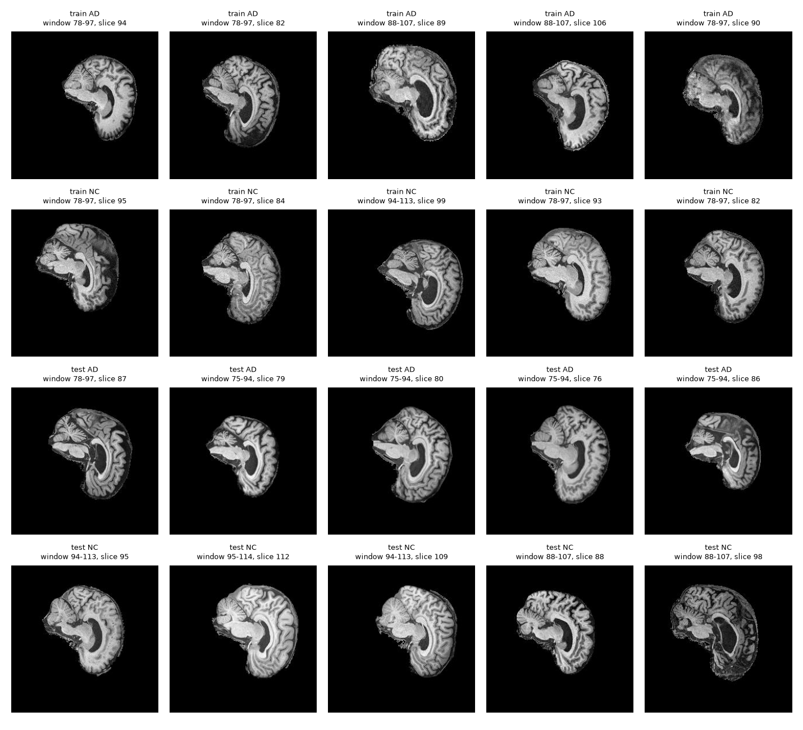
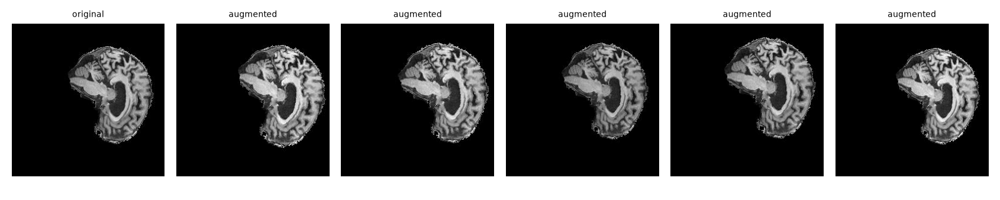

# ConvNeXt for Alzheimer's Disease Classification from ADNI Brain MRI

## 1. Introduction and Summary
PLACEHOLDER

## 2. The Problem and the Algorithm
The task at hand is a binary classification problem on complex medical
images: given a singular two-dimensional slice taken from a T1-weighted
structural brain MRI, can it be decided whether the slice comes from a
patient that has Alzheimer's disease (AD), or from that of a cognitavely
normal control group (NC). The signal is anatomical and diffuse; atrophy of
the hippocampus and cortex, and enlargement of the ventricles present
themselves as subtle changes in both shape and texture, varying against a
background of natural differences in head shape and age between people. A
classifier therefore must learn which structural patterns carry diagnostic
information, and which are merely variation of the individual person. 
Furthermore, it must do so from a limited number of patients, due to the
highly correlated nature of each slice, many coming from the same patient.

Convolutional networks suit this setting for the fact that they incorporate
two key assumptions that the images satisfy. Firstly, nearby pixels are
related, and the same local pattern can matter anywhere within a particular
image. ConvNeXt, introduced by Liu et al. (2022) is a modernised form of the
convolutional network -- it begins as a ResNet, and continually adopts the
design decisions that resulted in the success of vision transformers, whilst
retaining the pure convolutional nature that gives it its name. The resultant
fransework is a network that matches transformer-style accuracy without
attention, which keeps it simple in terms of implementation, efficient on a 
single GPU, and well behaved on smaller-scale datasets. In this project, the
ConvNet for the 2020s (ConvNeXt) is implemented from scratch in PyTorch and
trained from random initialisation.

The network processes a slice in a fixed sequence of steps: a patchifying
stem and a 4 by 4 convolution with stride 4 followed by layer normalisation
turns the 224 by 224 slice into a 56 by 56 map of 96 channels. This map then
passes through four stages of residual blocks, with 3, 3, 9, and 3 blocks in
the Tiny variant. Between stages, a layer normalisation and a 2 by 2
convolution with stride 2 halve the spatial resolution, and double the
channels, producing maps of 28 by 28 with 192 channels, 14 by 14 with 384,
and finally 7 by 7 with 768. Each block applies a 7 by 7 depthwise
convolution, which gathers wide spatial context cheaply by filtering each
channel separately, then a layer normalisation, then an inverted bottleneck:
a linear layer expanding the channels fourfold, a GELU activation, and a
linear layer projecting back. The block output is multiplied by a learnable
per-channel scale, initialised at 1e-6 so that each block starts close to
the identity and training begins from a stable point, and is added back to 
the block input through a residual connection. Stochastic depth randomly
drops entire residual branches during training, with a probability that
increases with depth, which serves to regularise the network. After the last
stage, global average pooling collapses each feature map to a singular
number per channel, and a layer normalisation, dropout and a linear layer
turn the 768 values into two logits. A softmax converts them into 
probabilities of NC and AD, and the probability of the predicted class is the
confidence score analysed further in Section 9. 

Two size presets were used. The Tiny variant has the depths and widths
mentioned above, and 27,818,594 parameters. The Mini variant has stage depths
of 2, 2, 6, and 2, and widths of 64, 128, 256, and 512, with 8,531,650
parameters, and is used to test whether the extra capacity assists. For
comparison, two small baselines were implemented: a four-stage plain CNN with
97,650 parameters, and a compact ResNet with 700,146 parameters, both
operating on the same inputs and evaluated against the same splits, so that
the added complexity of ConvNeXt can truly be examined. 


## 3. Feasibility review

### Feasibility Review: AD vs CN Classification on ADNI with ConvNeXt

COMP3710 Pattern Recognition | William O'Driscoll, 48849470

#### 1. User need, scope and acceptance criteria

User: A clinician reviewing screening T1-weighted brain MRIs who needs a classifier that decides confident cases automatically and routes uncertain ones to an expert. Scope. A prototype classifying 2D ADNI slices as Alzheimer's disease (AD) or cognitively normal (CN), and testing whether its confidence is trustworthy compared with simpler baselines (the open dilemma). Targets are provisional.

1. Accuracy: per-slice test accuracy ≥ 0.80 on a subject-level split, with a 95% bootstrap interval resampled over subjects.
2. Beyond the shortcut: exceed the slice-window-only baseline (66.2% on test) and, within each mixed-class window, exceed that window's majority-class rate.
3. Calibration: ECE and reliability diagrams for the CNN, ResNet and ConvNeXt, comparing confidence on correct and wrong predictions; ConvNeXt compared with the baselines on macro-F1, AUROC and ECE.
4. Reject option: a confidence threshold giving ≥ 0.90 accuracy on accepted slices at ≥ 50% coverage, with coverage and residual errors reported.
5. Resources: peak GPU memory ≤ 16 GB and ≤ 6 h per training run on one A100.

#### 2. Model choice and course concepts

Data: ADNI AD/CN 2D slices (256×240 grayscale, 20 per scan), zero-padded to 256×256 so stage resolutions halve cleanly. Model: a reduced ConvNeXt (Liu et al., 2022; Hard difficulty) trained from scratch, as pretrained weights are not permitted. ConvNeXt-T uses four stages with 3, 3, 9 and 3 blocks and widths of 96 to 768. The reduced model keeps the same block design (4×4 patchify stem, 7×7 depthwise convolution, LayerNorm, 4× inverted bottleneck with a single GELU, layer scale and stochastic depth) but uses fewer blocks and channels to suit the dataset size and compute budget. In the paper's ablations these design steps raise ImageNet-1K top-1 accuracy from 78.8% to 82.0% (ResNet-50 regime). That evidence comes from far larger data, so transfer to small brain-MRI data is tested, not assumed. Training uses AdamW with weight decay and a cosine schedule. Augmentation is mild (small rotation, shift, scale and intensity jitter) with no flips, because left–right flips of these sagittal-looking slices would swap the front and back of the head. Baselines: window-only, CNN and ResNet on identical splits, giving a progression from no anatomy, to plain local filters, to residual local filters, to a modern design. Evaluation: per slice, as recommended for 2D models, with confidence intervals resampled over subjects. Course concepts: convolutional inductive bias, normalisation, regularisation (weight decay, stochastic depth, augmentation), probabilistic calibration and selective prediction (risk–coverage).

#### 3. Preliminary feasibility evidence

Data audit (1,526 scans, 680 subjects, 30,520 slices): the provided train/test folders share 216 of 331 test subjects, so all scans are pooled and re-split by subject (70/15/15, seed 42). The test set holds 102 subjects (33 AD), 219 scans and 4,380 slices. No subject has both classes. Slice window is strongly tied to class: a window-only rule fitted on the training split scores 66.2% on test (65.5% validation) against 55.7% for always predicting the training majority, so about 10 points of any result can come from slice depth alone. Accuracy is therefore also reported per window. Pipeline test: a short run (3 epochs on a 2,000-slice subset) exercised data loading, the CNN, the training loop and checkpointing end to end; accuracy at that scale is not meaningful.

#### 4. Risks, budget, next experiment and fallback

Risks and mitigations: (i) the subject-level split lowers accuracy relative to the leaking provided split, and 0.80 may be hard from scratch; stochastic depth, weight decay, augmentation and early stopping on validation address overfitting. (ii) The slice-window shortcut; the window-only baseline, per-window accuracy and a window check on failure cases expose it. (iii) A small effective test set (102 subjects) gives wide intervals; differences between models are claimed only where bootstrap intervals separate. (iv) GPU queue waits of about 12 h limit the number of runs; jobs are submitted early as batch scripts, tested on small subsets first, with several configurations per job where possible. Budget: one A100 through Slurm batch jobs, each capped at 6 h, with a planned total of about eight runs (CNN, ResNet, three to four ConvNeXt configurations and final seeds). Next experiment: a full CNN baseline run, then a first ConvNeXt run after a one-batch overfitting check. Fallback: if ConvNeXt misses 0.80, first reduce width and depth or strengthen regularisation; if it is still short, report the result, since the calibration, reject-option and failure analysis carry the dilemma investigation. A second architecture (GFNet) is only attempted after the core analysis is complete.


## 4. Dependencies and Reproducibility
All of the experiments were run on the Rangpur cluster from the University
of Queensland, in a Miniconda environment named torch, with Python 3.11.15,
on a single NVIDIA A100 40GB GPU (PCIe) allocated through Slurm in the
comp3710 partition. The code depends on PyTorch 2.13.0 built for CUDA 13.0
with cuDNN 9.20.0, torchvision 0.28.0, NumPy 2.4.6, Pillow 12.3.0, 
Matplotlib 3.11.1 and scikit-learn 1.9.1. These versions are pinned in
requirements.txt. PyTorch 2.6 or later is assumed: checkpoints are loaded
with weights_only=False because they carry the training configuration
alongside the weights, and the scripts are written for that behaviour. The
data are read in place from the course directory /home/groups/comp3710/ADNI
and are not copied into the repository.

Every source of randomness controlled by the code is seeded. A single seed
of 42 fixes the subject-level split, the stratified division of the provided
training folder into training and validation sets, weight initialisation,
data-loader shuffling, augmentation and mixup. The normalisation statistics
are computed from the training images of the chosen split and written to a
file on first use, so that each protocol has its own unique statistics file.
Runs are not bitwise reproducible by default, since cuDNN autotuning, mixed-precision arithmetic, and multi-worker data loading introduce small
nondeterministic differences. Passing the --deterministic flag disables
autotuning and makes repeated runs on the same hardware much closer, at the
cost of speed, but does not guarantee identical results across different GPUs
or library versions. Every reported result comes from a single seed, so
differences of about a point between runs should be read as within run-to-run
noise, and this limitation is discussed further in Section 10.

Each training run is a singular Slurm job that executes train.py. The 
ConvNeXt-Tiny headline run on the provided split can be reproduced with the
first command below. The remaining commands reproduce the other models in the
experiment ladder, the two baselines, and the patient-disjoint development
runs discussed further. Evaluation on the test set happens once, at the end
of a job, when --eval-test is given, and a job reports the test accuracy of
the checkpoint with the best validation accuracy. A 100-epoch ConvNeXt run
takes between 2.8 and 3.3 hours on the A100 (173 minutes for the resizecrop
Tiny model, and 197 for the Tiny model with default recipe, which uses 
larger inputs), and the baselines also sit inside the six-hour limit of the
job script.
```
# headline experiment ladder, provided split
sbatch slurm/train.sh --recipe resizecrop --variant tiny --epochs 100 --split-mode provided --eval-test --run-name prov_rc
sbatch slurm/train.sh --recipe resizecrop --variant tiny --epochs 100 --patience 100 --mixup-alpha 0.4 --split-mode provided --eval-test --run-name prov_mix
sbatch slurm/train.sh --variant tiny --split-mode provided --eval-test --run-name prov_tiny_a
sbatch slurm/train.sh --variant mini --split-mode provided --eval-test --run-name prov_mini_a

# baselines, provided split
sbatch slurm/train.sh --model cnn --recipe resizecrop --epochs 100 --split-mode provided --eval-test --run-name prov_cnn
sbatch slurm/train.sh --model resnet --recipe resizecrop --epochs 100 --split-mode provided --eval-test --run-name prov_resnet

# supplementary development runs, patient-disjoint split (the default split mode)
sbatch slurm/train.sh --recipe resizecrop --variant tiny --epochs 100 --run-name tiny_rc
sbatch slurm/train.sh --recipe resizecrop --variant tiny --epochs 100 --patience 100 --mixup-alpha 0.4 --select-metric patient_auc --run-name tiny_mix
sbatch slurm/train.sh --recipe resizecrop --variant tiny --epochs 100 --patience 100 --select-metric patient_auc --run-name tiny_pauc
sbatch slurm/train.sh --variant tiny --run-name tiny_a
sbatch slurm/train.sh --variant mini --run-name mini_a
```

Predictions, confidence and failure analyses, and the profiling table are
produced from the saved checkpoints without need for retraining. The script's
per_patient.py and export_preds.py write each model's predicted probabilities
for the validation and test slices to results/preds, and the analysis scripts
of Section 9 read only those files, so the figures and tables in this report
can be regenerated in a few minutes once the checkpoints exist. Slurm reads
the above code when a job starts, so the repository should be at the latest
commit before any job is submitted. Training logs, checkpoints, and
normalisation statistics are generated by the scripts and not commited to the
repository.


## 5. Dataset, Preprocessing, and Splits
The data are all T1-weighted structural brain MRIs from the Alzheimer's
Disease Neuroimaging Initiative (ADNI), supplied as two-dimensional grayscale
JPEG slices of 240 by 256 pixels in the course directory, which is organised
into train and test folders, and then into AD and NC subfolders. Each file is
named with a scan number, followed by a slice number, for example,
392586_92.jpeg, and every scan contributes 20 slices, so the full collection
holds 30,520 slices from 1,526 scans. The metadata file meta_data_with_label.json gives the diagnosis for each scan, and a path from which the patient
identifier can be read. That identifier shows that the 1,526 scans belong
to only 680 patients, corresponding to approximately 2.2 scans per patient,
and that no patient has scans from both diagnosis groups. The number at the
start of each filename therefore identifies a scan rather than a patient,
and treating it as a patient identifier would place one person's scans on
both sides of a split.

Each scan also has a slice window, which is the lowest and highest index
slice observed for it, and the window carries class information. A rule that
predicts from the window alone, fitted on training data, scores well above
chance: 66.2% on the patient-disjoint test set and 63.1% on the provided test
set, against 55.7% and 50.4% for always predicting the majority class. Part
of any model's accuracy can thus come from knowing where in the head a slice
was taken, and not from anatomy. For this reason, a window-only baseline is
reported alongside the models, and the results are examined per window.

Two preprocessing pipelines were experimented with. In the first, each slice
is zero-padded to a 256 by 256 square. In the second, which is the recipe of
the headline experiments, each slice is stretched to a square without padding
and fed to the network at 224 by 224 pixels, so that the 4 by 4 stem of
ConvNeXt produces a 56 by 56 feature map. In both cases, the single-channel
intensities are standardised with a mean and standard deviation computed from
the training images of the split in use only, so that no validation or test
image influences the normalisation, and separate statistics are stored for
each protocol and preprocessing choice. Evaluation images undergo only the
resizing or padding and the normalisation for consistency.

Training images are augmented in order to help prevent overfitting. In the
resize-and-crop recipe, a slice is stretched to 256 by 256, cropped at random
to 224 by 224 (scale 0.9 to 1.0, aspect ratio 0.9 to 1.1), flipped horizontally with probability 0.5, rotated up by 15 degrees, translated by
up to 10%, rescaled by 0.9 to 1.0, jittered in brightness (10%) and contrast
(15%) and lightly blurred. The earlier default recipe pads to 256 by 256 and
applies stronger geometric and intensity changes: rotation up to 15 degrees,
translation up to 8%, scale 0.85 to 1.15, brightness and contrast jitter of
30%, a random gamma between 0.7 and 1.5, small random erasing and the
occasional Gaussian blur. The feasibility review advised against horizontal
flips, on the grounds that they would swap the front and back of a
sagittal-looking slice. The rezie-and-crop recipe nevertheless includes them,
as it was an experimental design aimed to minimise considerable overfitting
behaviour of the ConvNeXt model.



*Figure 1. Randomly drawn slices from the patient-disjoint training and test sets for each diagnosis, labelled with the slice window and slice index. The zero padding added to reach a square is visible as black borders.*



*Figure 2. One training slice shown first unaltered and then with five independent random augmentations drawn from the padded pipeline with the mild preset. The headline resize-and-crop recipe applies different transformations, listed in the text above.*

Two evaluation protocols were used as well. The first follows the course
materials: the supplied test folder (9,000 slices from 450 scans and 331
patients, 200 of them NC and 131 AD) is the test set, and the supplied train
folder (21,520 slices from 1,076 scans and 565 patients) is divided into
training and validation sets by scan, stratified by diagnosis, with 15% of
scans held out for validation. This leaves 18,300 training slices (915 scans
from 520 patients, 368 NC and 152 AD) and 3,220 validation slices (161 scans
from 139 patients, 79 NC and 60 AD). This provided split is the one used for
the headline comparison of models further in the report. The second protocol
pools all scans and splits by patient, stratified by diagnosis, into 70%
training, 15% validation, and 15% test, with a fixed seed of 42 so that every
patient slice lives in exactly one set. The training set holds 476 patients
(321 NC, 155 AD), and 21,560 slices, and the validation and test sets each
hold 102 patients (69 NC, 33 AD), the test set comprising 219 scans and
4,380 slices. Patients are about two to one NC to AD, while slices are almost
balanced (about 51% to 49%), because AD patients contribute more scans each.
This patient-disjoint split was used for development and for the supplementary analysis discussed further.

By patient identifier from the metadata, 216 of the 331 provided test patients (65%) also appear in the provided training folder, and 94 of the 139
patients in the validation set carved form that folder (68%) appear in the
training portion. This constitutes a serious patient-level data leak and
changes what the model learns. Trained on the provided split, the best
ConvNeXt model scores 0.92 per slice on the 5,560 test slices from patients
already seen in training and 0.52 on the 3,440 slices from unseen patients,
and its validation accuracy of 0.89 to 0.95 across models is far above the
approximate 0.69 reached when validation patients are entirely held-out.
Because validation accuracy under the provided protocol rewards patient-level
memorisation, it was not used to choice between recipes: those choices rest
on the patient-disjoint development runs described previously, and the
provided-split runs are reported in full without selecting among them on
test-set accuracy.


### ConvNeXt paper notes (Liu et al., 2022, arXiv:2201.03545)

**Macro design**
- Four stages with a 1:1:3:1 block ratio. ConvNeXt-T uses depths (3, 3, 9, 3) and channels (96, 192, 384, 768), with channels doubling each stage.
- Patchify stem: 4×4 conv, stride 4, non-overlapping, followed by LayerNorm.
- Separate downsampling between stages: LayerNorm, then 2×2 conv with stride 2. Training diverged in the paper without these extra norms.
- Head: global average pool, LayerNorm, linear classifier.

**Block**
1. 7×7 depthwise conv
2. LayerNorm (one per block)
3. 1×1 conv, 4× expansion (inverted bottleneck)
4. GELU (one per block)
5. 1×1 conv back to C channels
6. Layer scale (learnable per-channel, initialised at 1e-6)
7. Stochastic depth, then residual add

**Ablation evidence (ResNet-50 regime, ImageNet-1K top-1, %)**

| Change | Accuracy |
|---|---|
| Enhanced training recipe (baseline) | 78.8 |
| Stage ratio 3:3:9:3 | 79.4 |
| Patchify stem | 79.5 |
| Depthwise conv, widened | 80.5 |
| Inverted bottleneck | 80.6 |
| Depthwise moved up, 7×7 kernel | 80.6 |
| GELU instead of ReLU | 80.6 (unchanged) |
| Fewer activations | 81.3 |
| Fewer norms | 81.4 |
| BatchNorm to LayerNorm | 81.5 |
| Separate downsampling convs | 82.0 |

Kernel-size gains saturated at 7×7 in this regime and at 5×5 in the larger one.

**Paper's training recipe (reference only)**
- AdamW, lr 4e-3, weight decay 0.05, cosine decay, 20 warmup epochs.
- Label smoothing 0.1, layer scale 1e-6, stochastic depth 0.1 for ConvNeXt-T (0.1/0.4/0.5/0.5 for T/S/B/L).
- Mixup, CutMix, RandAugment, Random Erasing and EMA were used on ImageNet. Each needs justifying or dropping for ADNI.

### Limitations and leads from the paper
- **Stated limitation (Appendix F):** ConvNeXt may suit some tasks better than Transformers, e.g. Transformers may be more flexible for multimodal learning or for sparse and structured outputs. Nothing is specific to medical imaging, so the failure analysis relies on my own results.
- **Overfitting:** the paper reports overfitting in larger models on ImageNet-1K and uses EMA to reduce it. ADNI is far smaller, which supports a reduced-size model with stochastic depth, weight decay and possibly EMA.
- **Efficiency:** at equal FLOPs, depthwise convs are known to be slower and more memory-hungry than dense convs, although the paper finds throughput comparable to Swin. To check this, the resource profile compares ConvNeXt latency and VRAM against the CNN, not just parameter counts.
- **Robustness:** the paper tests corrupted and out-of-distribution sets (Appendix B). A small perturbation test (noise, blur, intensity shifts) on ADNI slices could feed the calibration and failure analysis.
- **Scale of evidence:** all reported results are on large natural-image datasets. Design gains may not transfer to small grayscale brain MRI, so the retained-vs-shrunk table states what I kept and why, without assuming the paper's gains carry over.

### Rangpur setup
- Login: `ssh sXXXXXXX@rangpur.compute.eait.uq.edu.au` (UQ network or VPN required). The login node is used for editing, git and job submission only; all computation runs in Slurm jobs.
- Repository cloned over SSH into `$HOME`. Workflow: commit and push locally, then `git pull` on Rangpur.
- Environment: existing conda env `torch`, Python 3.11.15. Versions: torch 2.13.0, torchvision 0.28.0, numpy 2.4.6, matplotlib 3.11.1, pillow 12.3.0, scikit-learn 1.9.1.
- GPU check: `sbatch job.sh` (partition `comp3710`, `--gres=gpu:1`). Result: CUDA available.
- Interactive GPU debugging: `srun --partition=comp3710 --gres=gpu:1 --pty bash`.

### ADNI data audit
- Location: `/home/groups/comp3710/ADNI`. `AD_NC/{train,test}/{AD,NC}` holds 2D JPEG slices (256×240, grayscale). `meta_data_with_label.json` holds 2,189 scans with per-scan labels and file paths.
- Filenames follow `<scanID>_<sliceIndex>.jpeg`. All 1,526 scan IDs in `AD_NC` match JSON keys. The subject ID (`ADNI_<site>_S_<number>`) is parsed from the JSON `raw` path.
- Each scan contributes exactly 20 slices (indices 67 to 114). Provided split: train 1,076 scans (520 AD, 556 NC; 21,520 slices), test 450 scans (223 AD, 227 NC; 9,000 slices).
- 680 subjects with 1 to 8 scans each (282 with a single scan). No subject has both AD and NC scans (221 AD-only, 459 NC-only).
- Leakage: no scan appears in both provided splits, but 216 of 331 test subjects also appear in train. The provided split is not patient-level and is not used as is.
- JSON labels: 0 (NC) 810 scans, 1 (not in the folders) 625 scans, 2 (AD) 754 scans. Folders contain only labels 0 and 2.
- Slice windows: scans fall into 9 distinct 20-slice windows, and window is strongly associated with class. Window 75 to 94 holds 129 AD and 1 NC scan. Windows 94 to 113 and 95 to 114 hold 53 AD and 349 NC scans. A window-only majority classifier reaches 68.2% scan-level accuracy (1,041 of 1,526, fitted and scored on the same data) against 51.3% for always predicting NC. Slice depth is therefore a possible shortcut. Mitigation: report accuracy per window group and compare against a window-only baseline.
- Split plan: pool all scans, stratified 70/15/15 split by subject with a fixed seed, with a test asserting no subject spans two splits.

### Split design
- The provided train/test folders share 216 of 331 test subjects, so they are pooled (1,526 scans, 30,520 slices) and re-split by subject.
- Split unit: subject. All scans and slices of a subject go to one split. No subject has both classes, so class is the stratum.
- Ratios: 70/15/15 train/val/test, seed 42. Validation is used for tuning and early stopping. Test is used only for final results.
- Result: train 476 subjects (155 AD / 321 NC, 1,078 scans, 21,560 slices), val 102 (33 AD / 69 NC, 229 scans, 4,580 slices), test 102 (33 AD / 69 NC, 219 scans, 4,380 slices).
- Slice-level class balance: 49% AD in train, 50% in val, 44% in test. Always predicting NC gives 55.7% on test.
- Window mix is broadly similar across splits, but test has more scans in window 94-113 (26% vs 19% in train), a mostly NC window. Accuracy is reported per window for this reason.
- Limitation: the test set holds 102 subjects (33 AD), so confidence intervals are resampled over subjects, not slices.

### Input size
- All slices are 256 wide × 240 tall, single-channel (8-bit grayscale).
- With a stride-4 stem and three 2× downsamples, 240 rows give 60, 30, 15 and then 7 (the odd 15 drops a row). Padding to 256×256 gives 64, 32, 16, 8.
- Decision: zero-pad 8 rows at top and bottom to 256×256, applied before normalisation so padding matches the black background. No resampling, so no interpolation artefacts.
- Input size is a parameter (`img_size`, default 256) so a smaller size can be tested as an ablation.

### Augmentation and input size
- Slices are brain-extracted (no skull or scalp) and look sagittal, with the cerebellum at the upper left in every scan. The brain's position in the frame varies between scans, and image quality and contrast vary too (see `assets/sample_grid.png`).
- Input: 256×240 slices are zero-padded to 256×256 (8 rows top and bottom) so a stride-4 stem and three 2× downsamples give clean stage sizes of 64, 32, 16 and 8. Padding precedes normalisation and matches the black background. `img_size` is a parameter for ablations.
- Normalisation: mean 0.1086 and std 0.2200, computed on the padded training slices only.
- Augmentation (training only, applied after padding): rotation up to 8°, translation up to 3%, scale 0.95 to 1.05, and brightness and contrast jitter of 0.1. Position varies naturally between scans and contrast varies with scanner and acquisition, so these mimic real variation without cutting off the brain.
- No horizontal or vertical flips. In a sagittal view a left-right flip swaps front and back, producing anatomy that never occurs in the data.
- Candidate failure cases noted from the sample grid: train AD slice 90 (blurry, patchy upper edge) and test NC slice 98 (dark, unusual contrast).

### Smoke test
- Setup: SimpleCNN trained for 3 epochs on a random subset of slices (2,000 per split) as a pipeline check.
- Result: data loading, model, training loop, checkpointing and curve plotting ran end to end without errors. The run's loss, accuracy and timing values were not retained. Accuracy at this scale is not meaningful, so the test only shows that the pipeline is operational.
- Next: the full baseline CNN run (Phase 4) is the first logged result.

### ConvNeXt: retained from the paper vs shrunk

| Component | Paper (ConvNeXt-T) | This project | Why |
|---|---|---|---|
| Patchify stem | 4x4 conv, stride 4 | Retained (1 input channel) | Core design choice; also cuts compute on 256x256 slices |
| Block | 7x7 depthwise conv, LayerNorm, 4x inverted bottleneck, GELU | Retained | Core design |
| Layer scale | init 1e-6 | Retained | Stabilises training of a from-scratch network |
| Stochastic depth | linear rise to 0.1 | Retained, rate set per run | Main regulariser against overfitting 476 training subjects |
| Downsampling | separate LayerNorm + 2x2 stride-2 conv | Retained | Core design |
| Stage layout | 4 stages, depths 3-3-9-3 | 4 stages, depths 2-2-4-2 | Same shape, fewer blocks for ~21k training slices |
| Widths | 96-192-384-768 | 32-64-128-256 | Parameters cut from ~28M to 1.9M to suit the dataset size |
| Training | AdamW, cosine schedule, 300 epochs, batch 4096 | AdamW, cosine schedule with warmup, 30 epochs, batch 64 | Budget of one A100 and ~12 h queue waits |
| Heavy augmentation (RandAugment, Mixup, CutMix, EMA) | Used | Not used | Mixing slices is anatomically unrealistic; light affine and intensity jitter instead |

### Training run log (10 Oct 2026)

All runs use the subject-level split (seed 42), the same augmentation and the script defaults (4 CPUs, 4 data-loading workers, 3 h limit, one A100 on the `comp3710` partition). The course allows one running job per user, so the runs execute one after another.

| Run name | Job ID | Model | Command (after `sbatch --job-name=<name> slurm/train.sh`) |
|---|---|---|---|
| `cnn` | 646768 | CNN | `--model cnn --epochs 30` (constant LR, pipeline check) |
| `resnet_cos` | 646842 | ResNet | `--model resnet --epochs 30 --schedule cosine` |
| `cnn_cos` | 646843 | CNN | `--model cnn --epochs 30 --schedule cosine` |
| `convnext_a` | 646844 | ConvNeXt | `--model convnext --epochs 30 --schedule cosine --lr 1e-3 --weight-decay 0.05 --drop-path 0.1` |
| `convnext_b` | 646845 | ConvNeXt | as A with `--lr 5e-4` |
| `convnext_c` | 646846 | ConvNeXt | as A with `--weight-decay 0.1 --drop-path 0.2 --label-smoothing 0.1` |

The first CNN run (`cnn`) used a constant learning rate and serves as a pipeline check. It trains at about 90 s per epoch, limited by data loading. Its validation accuracy swings between about 0.50 and 0.73 while training accuracy reaches about 0.87, so the cosine-schedule runs form the matched comparison. ConvNeXt B and C each change one thing relative to A (learning rate, regularisation), and the final configuration is chosen on validation accuracy and validation loss only. Parameter counts: CNN about 94k, ResNet 700,146, ConvNeXt 1,899,874.

Second training round, submitted 11 Oct 10:05 (one running job per user, so serial):
convnext_d 649826 (strong augmentation), convnext_e 649827 (D plus mixup 0.4 and EMA 0.999),
convnext_f 649828 (E with a smaller ConvNeXt, depths 1/1/3/1, dims 24/48/96/192),
resnet_d 649829 and cnn_d 649830 (baselines with the same strong augmentation).
All use the cosine schedule, 30 epochs, seed 42; ConvNeXt runs use lr 5e-4.